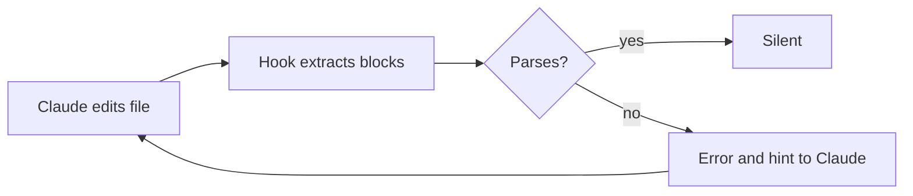

# mermaid-pro

A Claude Code plugin that makes Mermaid diagrams parse and read well.

- A skill points Claude at trimmed per-type syntax references (Mermaid v12.1.0) instead of its memory.
- A hook runs the real Mermaid parser on every `mermaid` code block Claude writes and feeds errors back with a fix hint.
- A command renders a file so Claude can look at the layout.

## Install

```sh
claude plugin marketplace add alexanderop/mermaid-pro
claude plugin install mermaid-pro@mermaid-pro
```

Node 22 or newer is needed for the hook.

## What the hook does

After every `Write`, `Edit` or `MultiEdit` on a Markdown or Mermaid file, the hook extracts each `mermaid` block and parses it with the bundled Mermaid 12.1.0. Errors exit with code 2, so Claude sees them and fixes the file before moving on.



Sample output:

```text
Mermaid validation failed. Fix these and re-save:
docs/flow.md:12 [flowchart-v2] Parse error at `A[Save (draft)] --> B`: Expecting 'SQE', ... got '1'
    hint: Labels containing ( ) { } or similar need quotes: A["Fuel (UO2)"] instead of A[Fuel (UO2)].
```

Each finding is `path:line [diagramType] message`, with an indented `hint:` line when the plugin knows the usual fix. Non-fatal findings are prefixed with `warning:`, for example the deprecated `%%{init}%%` directive or a diagram type that is newer than the Mermaid version your project uses.

## Look at the result

```text
/mermaid-pro:mermaid-check <file>
```

Renders the diagrams in a file so Claude can look at the layout. It tries these backends in order and skips the check when none is available:

1. `agent-browser`
2. `mmdc` (Mermaid CLI)

## The skill

`skills/mermaid/SKILL.md` gives Claude a workflow, a type picker, a version rule for older renderers (GitHub, Notion, Obsidian) and the mistakes models make most often. The references under `skills/mermaid/references/` hold one file per diagram type, plus `config.md` for frontmatter, themes and layout. Each starts with the header keyword, the release that added the type and a Pitfalls list.

## Regenerate the references

The references are generated, not hand-edited. They are trimmed copies of the Mermaid docs: syntax examples, tables and warning blocks stay, long prose and images go.

```sh
git clone --depth 1 --branch mermaid@12.1.0 https://github.com/mermaid-js/mermaid.git /tmp/mermaid
node tools/build-references.mjs /tmp/mermaid
```

The script has no dependencies, is deterministic, and reads the diagram list from `src/diagram-types.json`. When you bump Mermaid, update `mermaidVersion` and the `since` values there first.

## Development

```sh
npm install
npm test
```

`npm test` rebuilds `dist/validate.mjs` and runs the validator tests.

## License

MIT
