> Mermaid v12.1.0 · source: packages/mermaid/src/docs/syntax/block.md · header: `block` · since 10.8.0

# Block Diagrams Documentation

## Introduction to Block Diagrams
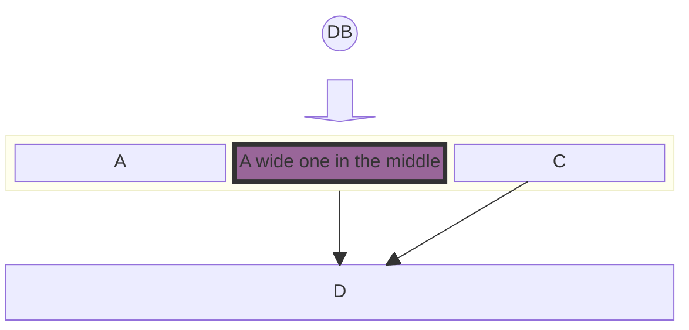

### Definition and Purpose
Block diagrams are an intuitive and efficient way to represent complex systems, processes, or architectures visually.

The primary purpose of block diagrams is to provide a high-level view of a system, allowing for easy understanding and analysis without delving into the intricate details of each component.

Many people use mermaid flowcharts for this purpose. A side-effect of this is that the automatic layout sometimes move shapes to positions that the diagram maker does not want. Block diagrams use a different approach.

### General Use Cases
Block diagrams have a wide range of applications across various industries and disciplines. Some of the key use cases include:

- **Software Architecture**: In software development, block diagrams can be used to illustrate the architecture of a software application.
- **Network Diagrams**: Block diagrams are ideal for representing network architectures in IT and telecommunications.
- **Process Flowcharts**: In business and manufacturing, block diagrams can be employed to create process flowcharts.
- **Electrical Systems**: Engineers use block diagrams to represent electrical systems and circuitry.
- **Educational Purposes**: Block diagrams are also extensively used in educational materials to explain complex concepts and systems in a simplified manner.

These examples demonstrate the versatility of block diagrams in providing clear and concise representations of complex systems.

In the following sections, we will delve into the specifics of creating and manipulating block diagrams using Mermaid, covering everything from basic syntax to advanced configurations and styling.

Creating block diagrams with Mermaid is straightforward and accessible. This section introduces the basic syntax and structure needed to start building simple diagrams.
#### Basic Structure
At its core, a block diagram consists of blocks representing different entities or components. In Mermaid, these blocks are easily created using simple text labels.

This example will produce a horizontal sequence of three blocks. Each block is automatically spaced and aligned for optimal readability.
#### Column Usage
While simple block diagrams are linear and straightforward, more complex systems may require a structured layout.

**Example - Multi-Column Diagram:** In scenarios where you need to distribute blocks across multiple columns, you can specify the number of columns and arrange the blocks accordingly.

This syntax instructs Mermaid to arrange the blocks 'a', 'b', 'c', and 'd' across three columns, wrapping to the next row as needed.

These basic building blocks of Mermaid's block diagrams provide a foundation for more complex diagramming.

## 3. Advanced Block Configuration
Building upon the basics, this section delves into more advanced features of block diagramming in Mermaid.
#### Spanning Multiple Columns
In more complex diagrams, you may need blocks that span multiple columns to emphasize certain components or to represent larger entities.

In this example, the block labeled "A labels" spans one column, while blocks 'b', 'c' span 2 columns, and 'd' is again allocated its own column.
#### Nested Blocks
Composite blocks, or blocks within blocks, are an advanced feature in Mermaid's block diagram syntax. They allow for the representation of nested or hierarchical systems, where one component encompasses several subcomponents.

In this syntax, 'D' is a nested block within a larger parent block. This feature is particularly useful for depicting complex structures, such as a server with multiple services or a department within a larger organizational framework.
#### Adjusting Widths
Mermaid also allows for dynamic adjustment of column widths based on the content of the blocks. The width of the columns is determined by the widest block in the column, ensuring that the diagram remains balanced and readable.

This example demonstrates how Mermaid dynamically adjusts the width of the columns to accommodate the widest block, in this case, 'a' and the composite block 'e'.

**Merging Blocks Horizontally:** In scenarios where you need to stack blocks horizontally, you can use column width to accomplish the task. Blocks can be arranged vertically by putting them in a single column.

In this example, the width of the merged block dynamically adjusts to the width of the largest child block.

With these advanced configuration options, Mermaid's block diagrams can be tailored to represent a wide array of complex systems and structures.

## 4. Block Varieties and Shapes
Mermaid's block diagrams are not limited to standard rectangular shapes. A variety of block shapes are available, allowing for a more nuanced and tailored representation of different types of information or entities.

### Standard and Special Block Shapes
Mermaid supports a range of block shapes to suit different diagramming needs, from basic geometric shapes to more specialized forms.
#### Example - Round Edged Block
To create a block with round edges, which can be used to represent a softer or more flexible component:
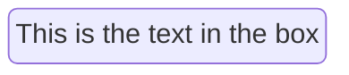
#### Example - Stadium-Shaped Block
A stadium-shaped block, resembling an elongated circle, can be used for components that are process-oriented:
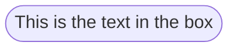
#### Example - Subroutine Shape
For representing subroutines or contained processes, a block with double vertical lines is useful:
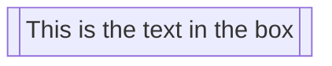
#### Example - Cylindrical Shape
The cylindrical shape is ideal for representing databases or storage components:
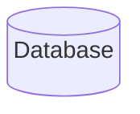
#### Example - Asymmetric, Rhombus, and Hexagon Shapes
For decision points, use a rhombus, and for unique or specialized processes, asymmetric and hexagon shapes can be utilized:

**Asymmetric**

**Rhombus**
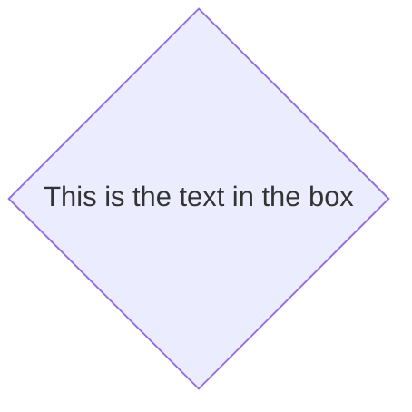
**Hexagon**
#### Example - Parallelogram and Trapezoid Shapes
Parallelogram and trapezoid shapes are perfect for inputs/outputs and transitional processes:
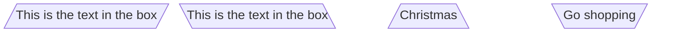
#### Example - Double Circle
For highlighting critical or high-priority components, a double circle can be effective:
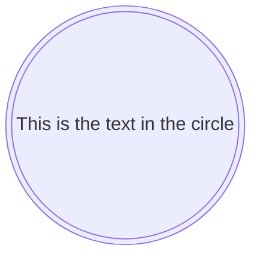

### Block Arrows and Space Blocks
Mermaid also offers unique shapes like block arrows and space blocks for directional flow and spacing.
#### Example - Block Arrows
Block arrows can visually indicate direction or flow within a process:
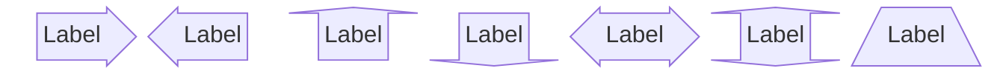
#### Example - Space Blocks
or
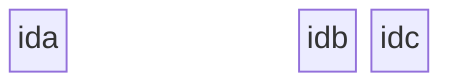
Note that you can set how many columns the space block occupied using the number notation `space:num` where num is a number indicating the num columns width. You can also use `space` which defaults to one column.

The variety of shapes and special blocks in Mermaid enhances the expressive power of block diagrams, allowing for more accurate and context-specific representations.

### Standard and Special Block Shapes
Discuss the various shapes available for blocks, including standard shapes and special forms like block arrows and space blocks.

## 5. Connecting Blocks with Edges
One of the key features of block diagrams in Mermaid is the ability to connect blocks using various types of edges or links.

### Basic Linking and Arrow Types
The most fundamental aspect of connecting blocks is the use of arrows or links. These connectors depict the relationships or the flow of information between the blocks.

**Example - Basic Links**

This example illustrates a direct connection from block 'A' to block 'B', using a straightforward arrow.

This syntax creates a line connecting 'A' and 'B', implying a relationship or connection without indicating a specific direction.

### Text on Links
In addition to connecting blocks, it's often necessary to describe or label the relationship. Mermaid allows for the inclusion of text on links, providing context to the connections.

Example - Text with Links To add text to a link, the syntax includes the text within the link definition:
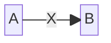
This example show how to add descriptive text to the links, enhancing the information conveyed by the diagram.

## 6. Styling and Customization
Beyond the structure and layout of block diagrams, Mermaid offers extensive styling options. These customization features allow for the creation of more visually distinctive and informative diagrams.

### Individual Block Styling
Mermaid enables detailed styling of individual blocks, allowing you to apply various CSS properties such as color, stroke, and border thickness.

### Class Styling
Mermaid enables applying styling to classes, which could make styling easier if you want to apply a certain set of styles to multiple elements, as you could just link those elements to a class.
#### Example - Styling a Single Class
In this example, a class named 'blue' is defined and applied to block 'A', while block 'B' receives individual styling. This demonstrates the flexibility of Mermaid in applying both shared and unique styles within the same diagram.

The ability to style blocks individually or through classes provides a powerful tool for enhancing the visual impact and clarity of block diagrams.

### 7. Practical Examples and Use Cases
The versatility of Mermaid's block diagrams becomes evident when applied to real-world scenarios. This section provides practical examples demonstrating the application of various features discussed in previous sections.

### Detailed Examples Illustrating Various Features
Combining the elements of structure, linking, and styling, we can create comprehensive diagrams that serve specific purposes in different contexts.
#### Example - System Architecture
This example shows a basic architecture with a frontend, backend, and database. The blocks are styled to differentiate between types of components.
#### Example - Business Process Flow
Representing a business process flow with decision points and multiple stages:
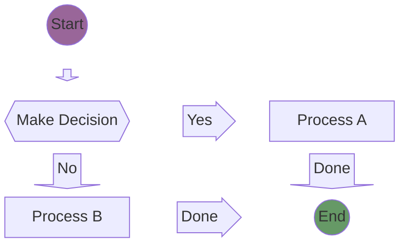
These practical examples and scenarios underscore the utility of Mermaid block diagrams in simplifying and effectively communicating complex information across various domains.

The next section, 'Troubleshooting and Common Issues', will provide insights into resolving common challenges encountered when working with Mermaid block diagrams, ensuring a smooth diagramming experience.

## 8. Troubleshooting and Common Issues
Working with Mermaid block diagrams can sometimes present challenges, especially as the complexity of the diagrams increases.

### Common Syntax Errors
Understanding and avoiding common syntax errors is key to a smooth experience with Mermaid diagrams.
#### Example - Incorrect Linking
**Correction**: Ensure that links between blocks are correctly specified with arrows (--> or ---) to define the direction and type of connection.
#### Example - Misplaced Styling
Applying styles in the wrong context or with incorrect syntax can lead to blocks not being styled as intended:
```mermaid
  block
    A
    style A fill#969;
```

### Tips for Complex Diagram Structures
Managing complexity in Mermaid diagrams involves planning and employing best practices.
#### Modular Design
Break down complex diagrams into smaller, more manageable components. This approach not only makes the diagram easier to understand but also simplifies the creation and maintenance process.
#### Consistent Styling
Use classes to maintain consistent styling across similar elements. This not only saves time but also ensures a cohesive and professional appearance.
#### Comments and Documentation
Use comments with `%%` within the Mermaid syntax to document the purpose of various parts of the diagram. This practice is invaluable for maintaining clarity, especially when working in teams or returning to a diagram after some time.

With these troubleshooting tips and best practices, you can effectively manage and resolve common issues in Mermaid block diagrams.
