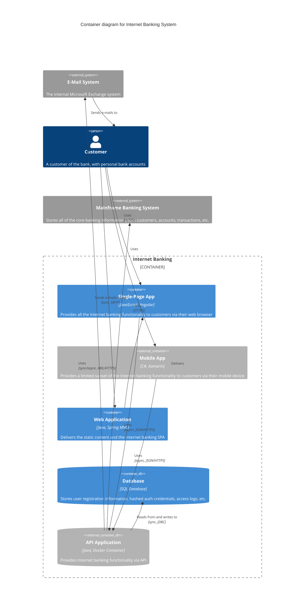
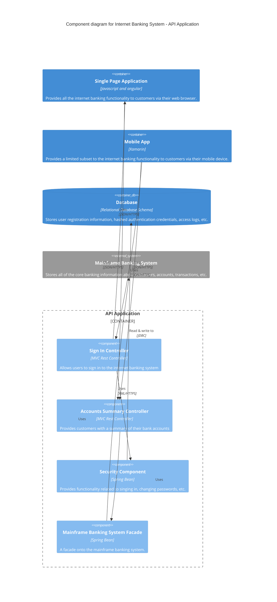
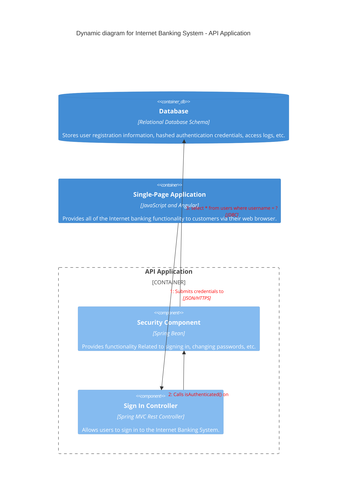

> Mermaid v12.1.0 · source: packages/mermaid/src/docs/syntax/c4.md · header: `C4Context` · since 9.0.0 · beta (header needs the `-beta` suffix)

# C4 Diagrams

- System Context (C4Context)
- Container diagram (C4Container)
- Component diagram (C4Component)
- Dynamic diagram (C4Dynamic)
- Deployment diagram (C4Deployment)
- Layout
  - Lay_U, Lay_Up
  - Lay_D, Lay_Down
  - Lay_L, Lay_Left
  - Lay_R, Lay_Right

The following unfinished features are not supported in the short term.

- [ ] sprite
- [ ] tags
- [ ] link
- [ ] Legend
- [x] System Context
  - [x] Person(alias, label, ?descr, ?sprite, ?tags, $link)
  - [x] Person_Ext
  - [x] System(alias, label, ?descr, ?sprite, ?tags, $link)
  - [x] SystemDb
  - [x] SystemQueue
  - [x] System_Ext
  - [x] SystemDb_Ext
  - [x] SystemQueue_Ext
  - [x] Boundary(alias, label, ?type, ?tags, $link)
  - [x] Enterprise_Boundary(alias, label, ?tags, $link)
  - [x] System_Boundary
- [x] Container diagram
  - [x] Container(alias, label, ?techn, ?descr, ?sprite, ?tags, $link)
  - [x] ContainerDb
  - [x] ContainerQueue
  - [x] Container_Ext
  - [x] ContainerDb_Ext
  - [x] ContainerQueue_Ext
  - [x] Container_Boundary(alias, label, ?tags, $link)
- [x] Component diagram
  - [x] Component(alias, label, ?techn, ?descr, ?sprite, ?tags, $link)
  - [x] ComponentDb
  - [x] ComponentQueue
  - [x] Component_Ext
  - [x] ComponentDb_Ext
  - [x] ComponentQueue_Ext
- [x] Dynamic diagram
  - [x] RelIndex(index, from, to, label, ?tags, $link)
- [x] Deployment diagram
  - [x] Deployment_Node(alias, label, ?type, ?descr, ?sprite, ?tags, $link)
  - [x] Node(alias, label, ?type, ?descr, ?sprite, ?tags, $link): short name of Deployment_Node()
  - [x] Node_L(alias, label, ?type, ?descr, ?sprite, ?tags, $link): left aligned Node()
  - [x] Node_R(alias, label, ?type, ?descr, ?sprite, ?tags, $link): right aligned Node()
- [x] Relationship Types
  - [x] Rel(from, to, label, ?techn, ?descr, ?sprite, ?tags, $link)
  - [x] BiRel (bidirectional relationship)
  - [x] Rel_U, Rel_Up
  - [x] Rel_D, Rel_Down
  - [x] Rel_L, Rel_Left
  - [x] Rel_R, Rel_Right
  - [x] Rel_Back
  - [x] RelIndex * Compatible with C4-PlantUML syntax, but ignores the index parameter. The sequence number is determined by the order in which the rel statements are written.
- [ ] Custom tags/stereotypes support and skin param updates
  - [ ] AddElementTag(tagStereo, ?bgColor, ?fontColor, ?borderColor, ?shadowing, ?shape, ?sprite, ?techn, ?legendText, ?legendSprite): Introduces a new element tag.
  - [ ] AddRelTag(tagStereo, ?textColor, ?lineColor, ?lineStyle, ?sprite, ?techn, ?legendText, ?legendSprite): Introduces a new Relationship tag.
  - [x] UpdateElementStyle(elementName, ?bgColor, ?fontColor, ?borderColor, ?shadowing, ?shape, ?sprite, ?techn, ?legendText, ?legendSprite): This call updates the default style of the elements (component, ...) and creates no additional legend entry.
  - [x] UpdateRelStyle(from, to, ?textColor, ?lineColor, ?offsetX, ?offsetY): This call updates the default relationship colors and creates no additional legend entry.
  - [ ] RoundedBoxShape(): This call returns the name of the rounded box shape and can be used as ?shape argument.
  - [ ] EightSidedShape(): This call returns the name of the eight sided shape and can be used as ?shape argument.
  - [ ] DashedLine(): This call returns the name of the dashed line and can be used as ?lineStyle argument.
  - [ ] DottedLine(): This call returns the name of the dotted line and can be used as ?lineStyle argument.
  - [ ] BoldLine(): This call returns the name of the bold line and can be used as ?lineStyle argument.
  - [x] UpdateLayoutConfig(?c4ShapeInRow, ?c4BoundaryInRow): New. This call updates the default c4ShapeInRow(4) and c4BoundaryInRow(2).

There are two ways to assign parameters with question marks.
```
UpdateRelStyle(customerA, bankA, "red", "blue", "-40", "60")
UpdateRelStyle(customerA, bankA, $offsetX="-40", $offsetY="60", $lineColor="blue", $textColor="red")
UpdateRelStyle(customerA, bankA, $offsetY="60")
```

## Element text wrapping
Since v11.17.1, C4 diagrams wrap by default and can be disabled by either setting wrap or c4.wrap to false. Before v11.17.1, wrapping was disabled by default, and could be enabled by setting wrap to true (but not c4.wrap).

Example below illustrates disabling of default wrapping by use of c4.wrap.
```yaml
---
config:
  c4:
    wrap: false
---
```

## C4 System Context Diagram (C4Context)
As above, "Banking Customer A" is red because the example restyles it with `UpdateElementStyle`, not because that is the default appearance of a `Person`.

## C4 Container diagram (C4Container)


## C4 Component diagram (C4Component)


## C4 Dynamic diagram (C4Dynamic)

