> Mermaid v12.1.0 · source: packages/mermaid/src/docs/syntax/classDiagram.md · header: `classDiagram` · since 8.0.0

# Class diagrams

## Pitfalls

- **Generic Types.** _note_ when a generic is used within a class definition, the generic type is NOT considered part of the class name. i.e.: for any syntax which required you to reference the class name, you need to drop the type part of the definition.

### Class
- The top compartment contains the name of the class. It is printed in bold and centered, and the first letter is capitalized.
- The middle compartment contains the attributes of the class. They are left-aligned and the first letter is lowercase.
- The bottom compartment contains the operations the class can execute. They are also left-aligned and the first letter is lowercase.
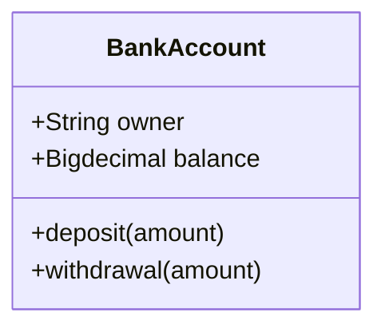

## Define a class
- Explicitly using keyword **class** like `class Animal` which would define the Animal class.
- Via a **relationship** which defines two classes at a time along with their relationship. For instance, `Vehicle <|-- Car`.
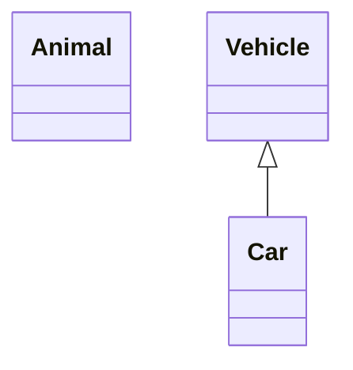
Naming convention: a class name should be composed only of alphanumeric characters (including unicode), underscores, and dashes (-).

### Class labels
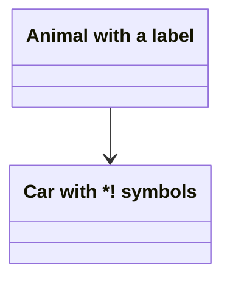

## Defining Members of a class
- Associate a member of a class using **:** (colon) followed by member name, useful to define one member at a time. For example:

- Associate members of a class using **{}** brackets, where members are grouped within curly brackets. Suitable for defining multiple members at once. For example:
#### Return Type
Optionally you can end a method/function definition with the data type that will be returned (note: there must be a space between the final `)` and the return type).
#### Generic Types
Generics can be represented as part of a class definition, and for class members/return types.
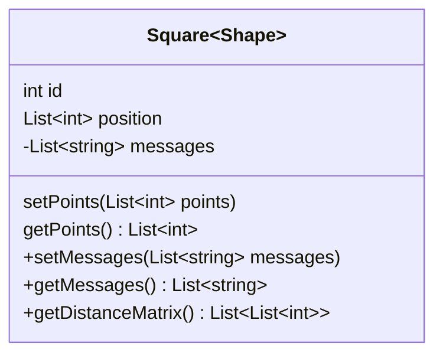
#### Visibility
- `+` Public
- `-` Private
- `#` Protected
- `~` Package/Internal

## Defining Relationship
| Type | Description |
|---|---|
| `<\|--` | Inheritance |
| `*--` | Composition |
| `o--` | Aggregation |
| `-->` | Association |
| `--` | Link (Solid) |
| `..>` | Dependency |
| `..\|>` | Realization |
| `..` | Link (Dashed) |
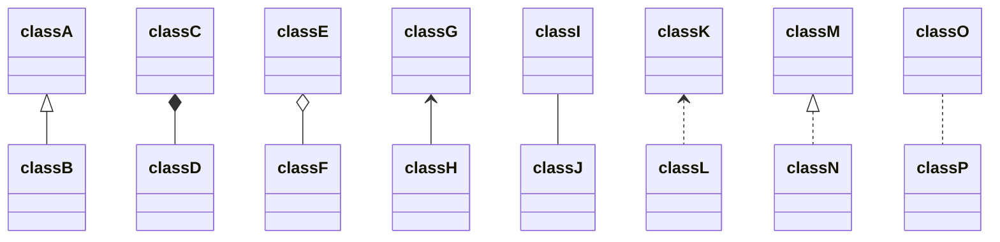
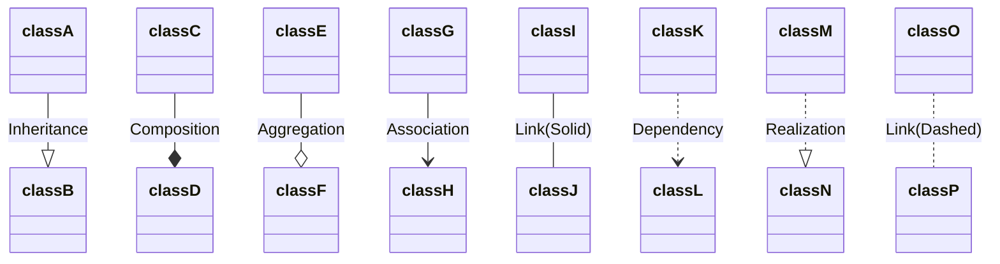

### Labels on Relations
```
[classA][Arrow][ClassB]:LabelText
```

### Two-way relations
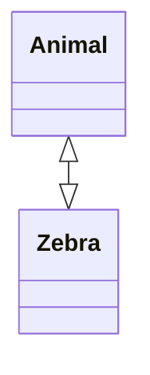
| Type | Description |
|---|---|
| `<\|` | Inheritance |
| `*` | Composition |
| `o` | Aggregation |
| `>` | Association |
| `<` | Association |
| `\|>` | Realization |

| Type | Description |
|---|---|
| -- | Solid |
| .. | Dashed |

### Lollipop Interfaces
- `bar ()-- foo`
- `foo --() bar`

Note: Each interface that is defined is unique and is meant to not be shared between classes / have multiple edges connecting to it.
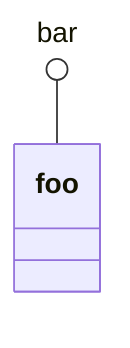

## Define Namespace
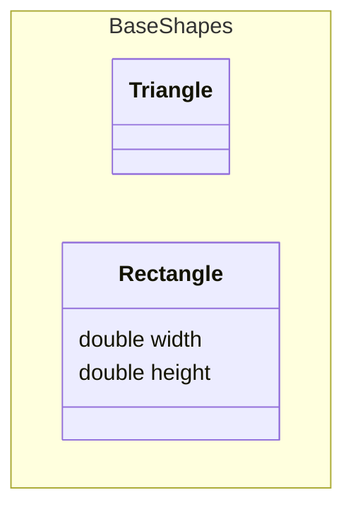
#### Compact rendering (`hierarchicalNamespaces: false`)
Setting `hierarchicalNamespaces: false` in the class diagram config switches to **compact mode**: only namespaces the user explicitly...

## Cardinality / Multiplicity on relations
- `1` Only 1
- `0..1` Zero or One
- `1..*` One or more
- `*` Many
- `n` n (where n>1)
- `0..n` zero to n (where n>1)
- `1..n` one to n (where n>1)
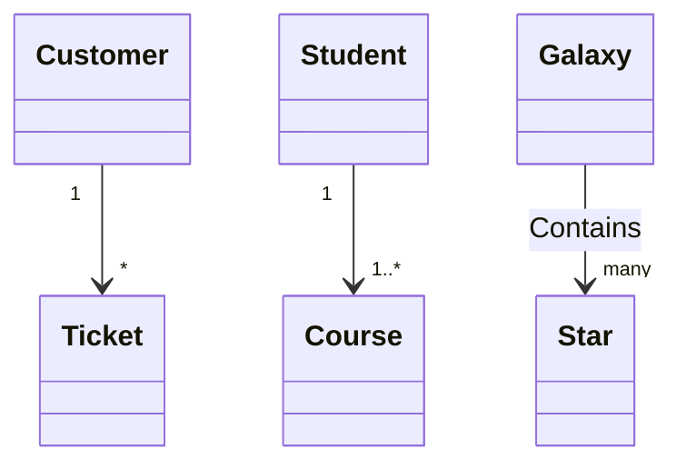

## Annotations on classes
- `<<Interface>>` To represent an Interface class
- `<<Abstract>>` To represent an abstract class
- `<<Service>>` To represent a service class
- `<<Enumeration>>` To represent an enum
- **Inline** with the class definition:
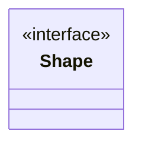
- In a **_separate line_** after a class is defined:

- In a **_nested structure_** along with the class definition:

## Comments
Comments can be entered within a class diagram, which will be ignored by the parser.
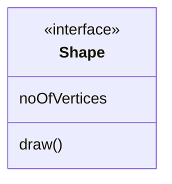

## Interaction
```
action className "reference" "tooltip"
click className call callback() "tooltip"
click className href "url" "tooltip"
```
- _action_ is either `link` or `callback`, depending on which type of interaction you want to have called
- _className_ is the id of the node that the action will be associated with
- _reference_ is either the url link, or the function name for callback.
- (_optional_) tooltip is a string to be displayed when hovering over element (note: The styles of the tooltip are set by the class .mermaidTooltip.)
- note: callback function will be called with the nodeId as parameter.

### Examples
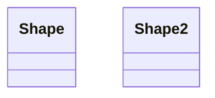

### Styling a node
Note that notes and namespaces cannot be styled individually but do support themes.
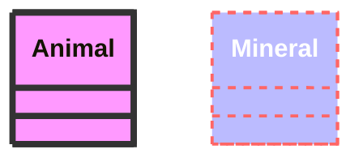
#### Classes
```
classDef className fill:#f9f,stroke:#333,stroke-width:4px;
```
```
cssClass "nodeId1" className;
```

### Default class
```
classDef default fill:#f9f,stroke:#333,stroke-width:4px;
```

### Possible configuration parameters:
| Parameter | Description | Default value |
|---|---|---|
| hideEmptyMembersBox | Hides the empty members box of a class node when set to true | false |
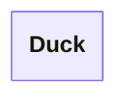
