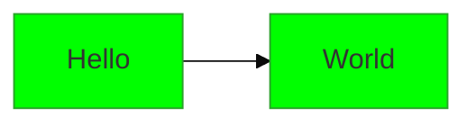

> Mermaid v12.1.0 · source: config/{directives,configuration,theming,layouts}.md under packages/mermaid/src/docs · frontmatter `config:` since 10.5.0

# Mermaid configuration, theming and layout

## Pitfalls

- **Directives (deprecated).** Directives are deprecated from v10.5.0. Please use the `config` key in frontmatter to pass configuration. See Configuration for more details.
- **Changing flowchart config via directive.** **Deprecated:** `flowchart.htmlLabels` has been deprecated from (v11.12.3+). Use the global `htmlLabels` configuration instead. For example, instead of `"flowchart": { "htmlLabels": true }`, use `"htmlLabels": true` at the top level.

## Essentials

- Configure one diagram with YAML frontmatter at the very top (since 10.5.0). `%%{init: ...}%%` directives still parse but are deprecated.

- Only the `base` theme accepts `themeVariables`. Colors must be hex (`#ff0000`), not names.
- Since 12.0.0 these diagrams default to the `redux-color` theme and `neo` look: flowchart, class, ER, requirement, sequence, state, usecase, venn, agentflow, swimlane. All others use `default` and `classic`.
- Since 12.0.0 ELK is bundled and is the default layout for flowchart, state, class, ER, requirement, usecase and agentflow. Do not write `layout: elk`. Write `layout: dagre` to opt out. Mindmap uses `cose-bilkent`.
- Scope a setting to one diagram type with its config key (`flowchart:`, `er:`, `sequence:`, `class:`, `state:`), for example `config: { flowchart: { look: handDrawn } }`.

## Configuration
When mermaid starts, configuration is extracted to determine a configuration to be used for a diagram. There are 3 sources for configuration:

- The default configuration
- Overrides at the site level are set by the initialize call, and will be applied to all diagrams in the site/app. The term for this is the **siteConfig**.
- Frontmatter (v10.5.0+) - diagram authors can update selected configuration parameters in the frontmatter of the diagram. These are applied to the render config.
- Directives (Deprecated by Frontmatter) - diagram authors can update selected configuration parameters directly in the diagram code via directives. These are applied to the render config.

**The render config** is configuration that is used when rendering by applying these configurations.

## Theming
Dynamic and integrated theme configuration was introduced in Mermaid version 8.7.0.

Themes can now be customized at the site-wide level, or on individual Mermaid diagrams. For site-wide theme customization, the `initialize` call is used. For diagram specific customization, frontmatter config is used.

### Available Themes
- **redux-color** - The default theme for the diagram types listed under Per-diagram defaults.
- **redux-dark-color** - The dark counterpart of `redux-color`.
- **redux** - The same geometry and typography as `redux-color`, but monochrome. Use this when you want the colour to carry meaning you assign yourself rather than being cycled per item.
- **redux-dark** - The dark counterpart of `redux`.
- **default** - The long-standing Mermaid look, and still the default for every diagram type not listed under Per-diagram defaults.
- **neutral** - This theme is great for black-and-white documents that will be printed.
- **dark** - This theme goes well with dark-colored elements or dark-mode.
- **forest** - This theme contains shades of green.
- **neo** - A flatter, softer look, intended to be paired with `look: neo`.
- **neo-dark** - The dark counterpart of `neo`.
- **base** - This is the only theme that can be modified. Use this theme as the base for customizations.

### Per-diagram defaults
Not every diagram type defaults to the same theme and look. Since v12.0.0 these do, to the `redux-color` theme and the `neo` look.

| Config key | Diagram |
|---|---|
| `agentflow` | `agentflow-beta` |
| `flowchart` | `flowchart` |
| `swimlane` | `swimlane-beta` |
| `class` | `classDiagram` |
| `er` | `erDiagram` |
| `requirement` | `requirementDiagram` |
| `sequence` | `sequenceDiagram` |
| `state` | `stateDiagram` |
| `usecase` | `usecase-beta` |
| `venn` | `venn-beta` |

Every other diagram type defaults to the `default` theme and the `classic` look.

These are only defaults, and the most specific thing you say wins. Highest priority first:

- The diagram's own frontmatter or `%%{init}%%` directive.
- What you passed to `mermaid.initialize()`.
- The diagram type's default, above.

Within each of the first two you can also scope a value to one diagram type, and the scoped value wins over the global one you set alongside it. `theme`, `look` and `layout` can all be set this way:

The same works in frontmatter, for one diagram:
```yaml
---
config:
  flowchart:
    look: handDrawn
---
```

### Theme Variables
| Variable | Default value | Description |
|---|---|---|
| darkMode | false | Affects how derived colors are calculated. Set value to `true` for dark mode. |
| background | #f4f4f4 | Used to calculate color for items that should either be background colored or contrasting to the background |
| fontFamily | trebuchet ms, verdana, arial | Font family for diagram text |
| fontSize | 16px | Font size in pixels |
| primaryColor | #fff4dd | Color to be used as background in nodes, other colors will be derived from this |
| primaryTextColor | calculated from darkMode #ddd/#333 | Color to be used as text color in nodes using `primaryColor` |
| secondaryColor | calculated from primaryColor |  |
| primaryBorderColor | calculated from primaryColor | Color to be used as border in nodes using `primaryColor` |
| secondaryBorderColor | calculated from secondaryColor | Color to be used as border in nodes using `secondaryColor` |
| secondaryTextColor | calculated from secondaryColor | Color to be used as text color in nodes using `secondaryColor` |
| tertiaryColor | calculated from primaryColor |  |
| tertiaryBorderColor | calculated from tertiaryColor | Color to be used as border in nodes using `tertiaryColor` |
| tertiaryTextColor | calculated from tertiaryColor | Color to be used as text color in nodes using `tertiaryColor` |
| noteBkgColor | #fff5ad | Color used as background in notes |
| noteTextColor | #333 | Text color in note rectangles |
| noteBorderColor | calculated from noteBkgColor | Border color in note rectangles |
| lineColor | calculated from background |  |
| textColor | calculated from primaryTextColor | Text in diagram over the background for instance text on labels and on signals in sequence diagram or the title in Gantt diagram |
| mainBkg | calculated from primaryColor | Background in flowchart objects like rects/circles, class diagram classes, sequence diagram etc |
| errorBkgColor | tertiaryColor | Color for syntax error message |
| errorTextColor | tertiaryTextColor | Color for syntax error message |

### Flowchart Variables
| Variable | Default value | Description |
|---|---|---|
| nodeBorder | primaryBorderColor | Node Border Color |
| clusterBkg | tertiaryColor | Background in subgraphs |
| clusterBorder | tertiaryBorderColor | Cluster Border Color |
| defaultLinkColor | lineColor | Link Color |
| titleColor | tertiaryTextColor | Title Color |
| edgeLabelBackground | calculated from secondaryColor |  |
| nodeTextColor | primaryTextColor | Color for text inside Nodes |

## Layouts
This page lists the available layout algorithms supported in Mermaid diagrams.

### Supported Layouts
- **elk** (default): ELK (Eclipse Layout Kernel). Bundled with Mermaid; no setup required.
- **dagre**: Dagre layout for layered graphs
- **cose-bilkent**: Cose Bilkent layout for force-directed graphs
- **tidy-tree**: Tidy tree layout for hierarchical diagrams, from the `@mermaid-js/layout-tidy-tree` package Tidy Tree Configuration

Mindmaps are the one diagram type not laid out with ELK by default; they use cose-bilkent unless you ask for something else.

The **tiny** build omits ELK to stay small, and falls back to Dagre for diagrams that request it. See ELK and the tiny build for how to register `@mermaid-js/layout-elk` there if you want ELK anyway.
