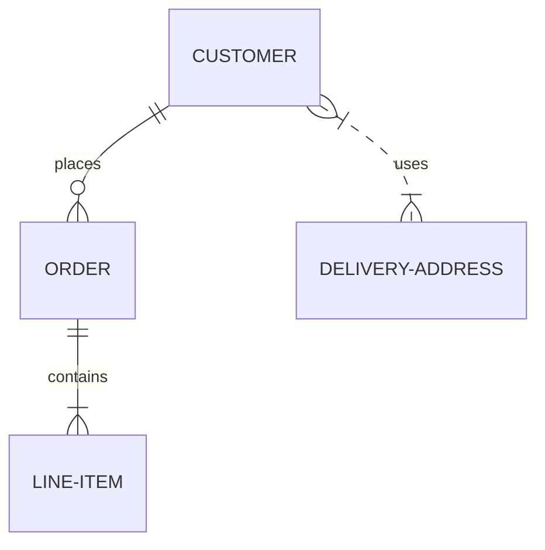
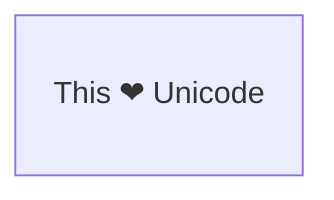
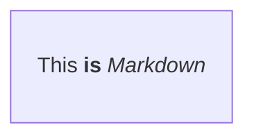
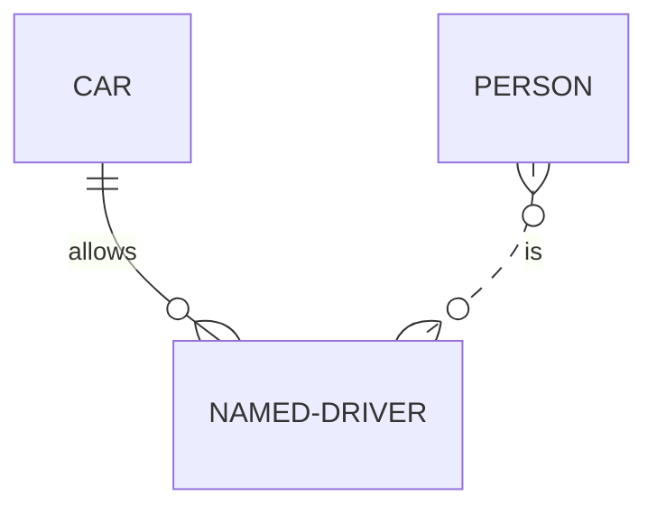
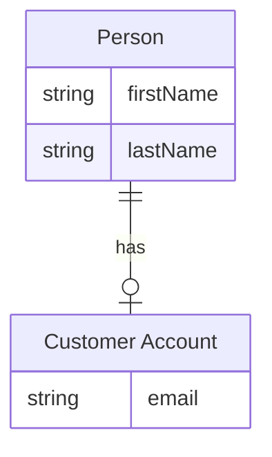
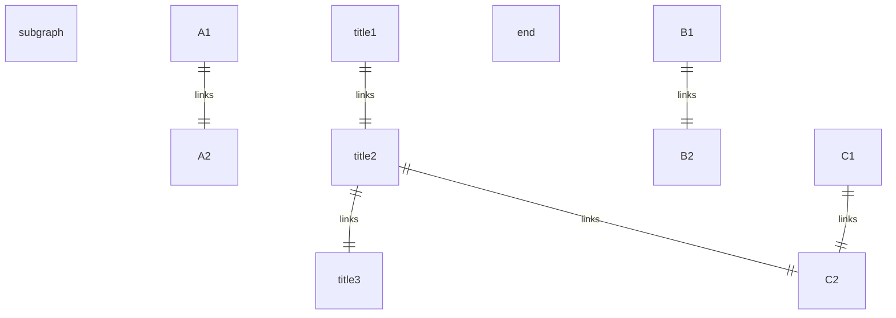
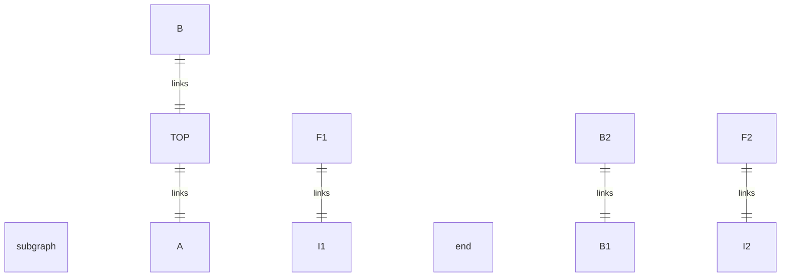
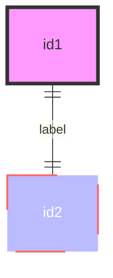

> Mermaid v12.1.0 · source: packages/mermaid/src/docs/syntax/entityRelationshipDiagram.md · header: `erDiagram` · since 8.0.0

# Entity Relationship Diagrams

## Pitfalls

- **Default class.** Custom styles from style or other class statements take priority and will overwrite the default styles. (e.g. The `default` class gives nodes a background color of pink but the `blue` class will give that node a background color of blue if applied.)
- **Subgraphs (v11.17.0+).** Subgraphs are always referenced by their id, never by their title. This is important when defining relationships involving subgraphs. **If a subgraph id contains spaces, it must be referenced using quotes:** ```"Customer Domain" ||--o{ ORDER : contains```


Entity names are often capitalised, although there is no accepted standard on this, and it is not required in Mermaid.

When including attributes on ER diagrams, you must decide whether to include foreign keys as attributes. This probably depends on how closely you are trying to represent relational table structures.

### Entities and Relationships
Mermaid syntax for ER diagrams is compatible with PlantUML, with an extension to label the relationship. Each statement consists of the following parts:
```
    <first-entity> [<relationship> <second-entity> : <relationship-label>]
```
Where:

- `first-entity` is the name of an entity. Names support any unicode characters and can include spaces if surrounded by double quotes (e.g. "name with space").
- `relationship` describes the way that both entities inter-relate. See below.
- `second-entity` is the name of the other entity.
- `relationship-label` describes the relationship from the perspective of the first entity.

For example:
```
    PROPERTY ||--|{ ROOM : contains
```
This statement can be read as _a property contains one or more rooms, and a room is part of one and only one property_.

Only the `first-entity` part of a statement is mandatory. This makes it possible to show an entity with no relationships, which can be useful during iterative construction of diagrams.
#### Unicode text
Entity names, relationships, and attributes all support unicode text.

#### Markdown formatting
Markdown formatting and text is also supported.


### Relationship Syntax
The `relationship` part of each statement can be broken down into three sub-components:

- the cardinality of the first entity with respect to the second
- whether the relationship confers identity on a 'child' entity
- the cardinality of the second entity with respect to the first

Cardinality is a property that describes how many elements of another entity can be related to the entity in question.

| Value (left) | Value (right) | Meaning |
|---|---|---|
| `\|o` | `o\|` | Zero or one |
| `\|\|` | `\|\|` | Exactly one |
| `}o` | `o{` | Zero or more (no upper limit) |
| `}\|` | `\|{` | One or more (no upper limit) |

**Aliases**

| Value (left) | Value (right) | Alias for |
|---|---|---|
| one or zero | one or zero | Zero or one |
| zero or one | zero or one | Zero or one |
| one or more | one or more | One or more |
| one or many | one or many | One or more |
| many(1) | many(1) | One or more |
| 1+ | 1+ | One or more |
| zero or more | zero or more | Zero or more |
| zero or many | zero or many | Zero or more |
| many(0) | many(0) | Zero or more |
| 0+ | 0+ | Zero or more |
| only one | only one | Exactly one |
| 1 | 1 | Exactly one |

### Identification
Relationships may be classified as either _identifying_ or _non-identifying_ and these are rendered with either solid or dashed lines respectively.

| Value | Alias for |
|---|---|
| -- | _identifying_ |
| .. | _non-identifying_ |

**Aliases**

| Value | Alias for |
|---|---|
| to | _identifying_ |
| optionally to | _non-identifying_ |



### Attributes
Attributes can be defined for entities by specifying the entity name followed by a block containing multiple `type name` pairs, where a block is delimited by an opening `{` and a closing `}`.

The `type` values must begin with an alphabetic character and may contain digits, hyphens, underscores, parentheses and square brackets.
#### Optional attribute types (v11.16.0+)
Attribute `type` values may end with `?` to indicate an optional or nullable type.
```mermaid
erDiagram
    PERSON {
        string firstName
        string? middleName
        string lastName
    }
```

### Entity Name Aliases
An alias can be added to an entity using square brackets. If provided, the alias will be showed in the diagram instead of the entity name. Alias names follow all of the same rules as entity names.

#### Attribute Keys and Comments
Attributes may also have a `key` or comment defined. Keys can be `PK`, `FK` or `UK`, for Primary Key, Foreign Key or Unique Key (markdown formatting and unicode is not supported for keys).

### Direction
The direction statement declares the direction of the diagram.

This declares that the diagram is oriented from top to bottom (`TB`). This can be reversed to be oriented from bottom to top (`BT`).

This declares that the diagram is oriented from left to right (`LR`). This can be reversed to be oriented from right to left (`RL`).

Possible diagram orientations are:

- TB - Top to bottom
- BT - Bottom to top
- RL - Right to left
- LR - Left to right

### Subgraphs (v11.17.0+)
Subgraphs allow grouping entities into logical sections within an ER diagram. They are useful for organizing complex diagrams and improving readability.

Subgraphs can contain entities, relationships, and even other subgraphs (nested subgraphs).
```
subgraph title
    graph definition
end
```
A subgraph always has an `id`, and optionally a `title`.

If the subgraph identifier contains more than one word, it must be written in `quotes`. In this case, the quoted value is used both as the id and the title.

You can also set an explicit id for the subgraph.
```mermaid
erDiagram
    subgraph id1 [title 1]
        CUSTOMER
    end
```
#### Relationships involving subgraphs
It is also possible to define relationships to and from subgraphs.

#### Direction in subgraphs
A subgraph can define its own layout direction.


### Styling a node
It is possible to apply specific styles such as a thicker border or a different background color to a node.

#### Classes
More convenient than defining the style every time is to define a class of styles and attach this class to the nodes that should have a different look.

Similar to the class statement, the shorthand syntax can also apply multiple classes at once:
```
    nodeId:::className1,className2
```

### Default class
If a class is named default it will be assigned to all classes without specific class definitions.
```
    classDef default fill:#f9f,stroke:#333,stroke-width:4px;
```

### Layout
The layout of the diagram is handled by `render()`. The default layout is the ELK (Eclipse Layout Kernel) layout, which suits larger and more-complex diagrams. For more information, see Customizing ELK Layout.

To use the classic Dagre layout instead, set it in your YAML frontmatter's `config`:
```yaml
---
config:
  layout: dagre
---
```
