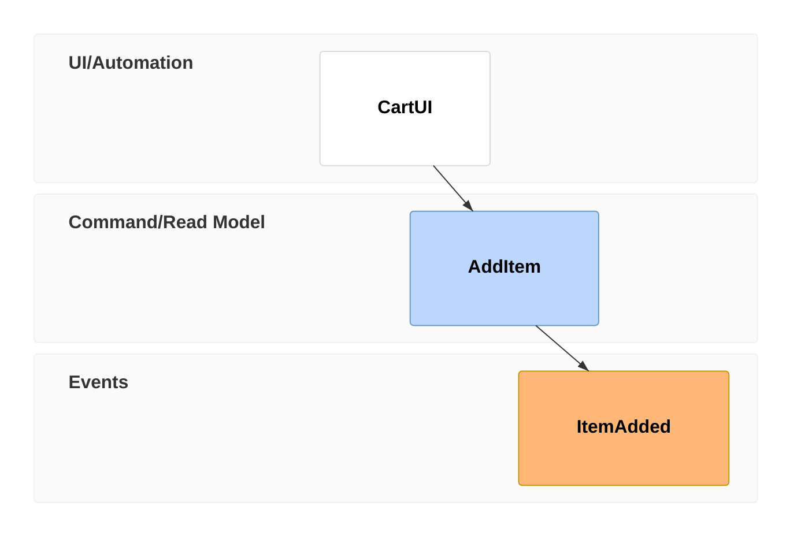
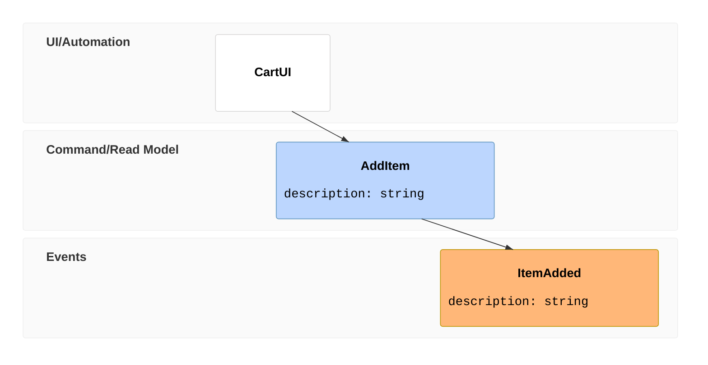
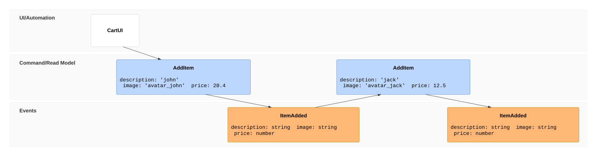
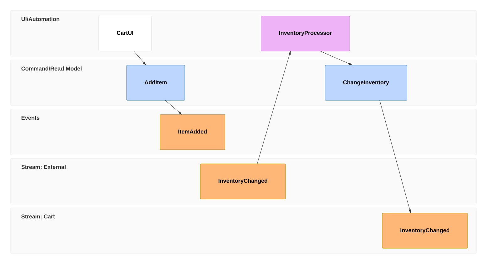
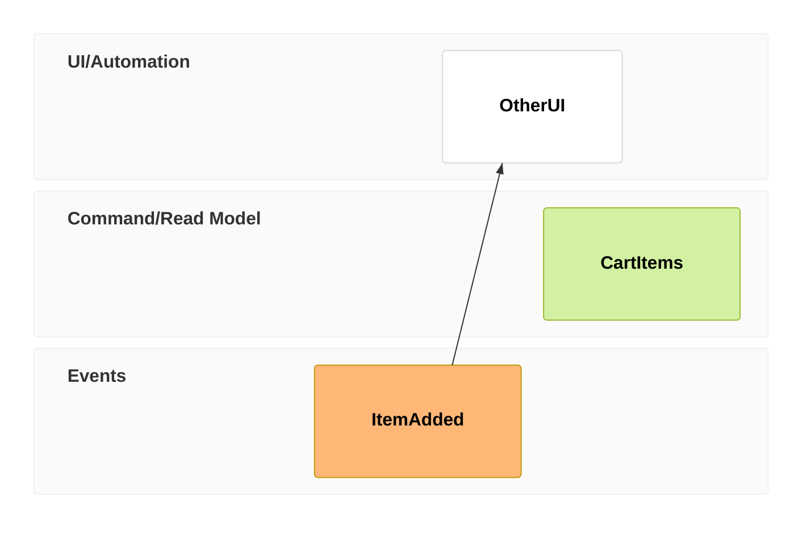
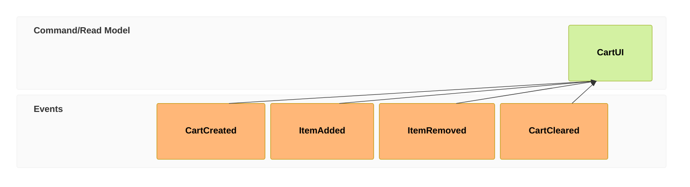
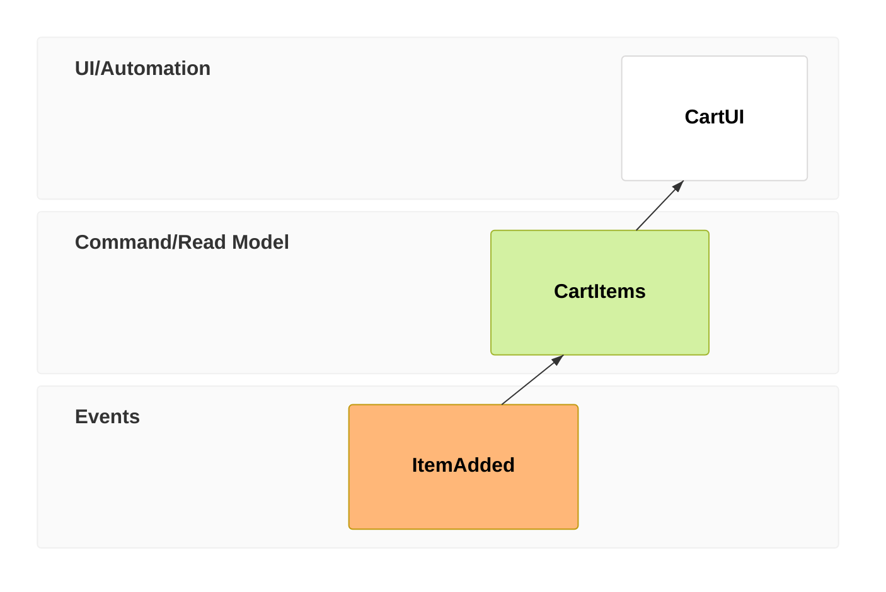
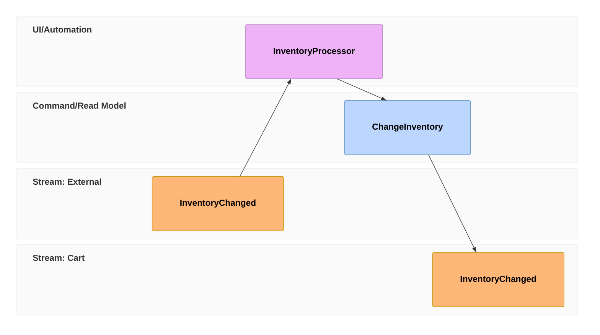
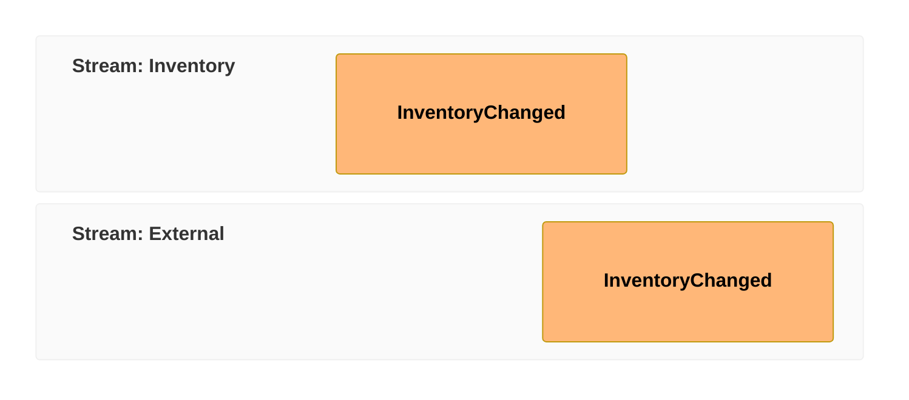

> Mermaid v12.1.0 · source: packages/mermaid/src/docs/syntax/eventmodeling.md · header: `eventmodeling` · since 11.15.0

# Event Modeling Diagram (v11.15.0+)

## Pitfalls

- **Data block data types.** There is no special treatment in the diagram renderer at the moment for a specific data type.

## Introduction
You can read more at Event Modeling web page.

Event Modeling diagram is composed of a few main entities:

- Trigger - UI and Processor
- Command
- View / Read Model
- Event

Entities are organized in swimlanes forming a timeline usually based on the following patterns:

- State View
- State Change
- Translation
- Automation

You can find more details in the cheat sheet.

The purpose of the Domain Specific Language (DSL) supporting the drawing of the Event Modeling diagram is the rapid creation. Relations among the entities are inferred by default, so the distraction while you design is limited.

The grammar for the DSL is also maintained in a separate project with the intention to provide also different types of output, VS Code (and potentially other) IDEs, etc.

## Basic Syntax
The DSL supports two types of syntaxes - compact and relaxed one. Both will be mentioned in the examples and both can be used interchangeably.

### Timeline
The timeline is the key part of the diagram and it is composed of **Time Frame** definitions. Speedy Time Frame typing is the key of the compact notation. For compact notation you type the `tf` token.

rendering to

Each Time Frame is referenced by a **unique number** in order to distinguish one from another and also to be able to reference it when needed.

Reusing a number for another Time Frame or Reset Frame produces an error. Give each frame its own number before referring to it with `->>`.

The Time Frame also contains an **Entity Identifier**, e.g. in case of `01` Time Frame it is `CartUI`.

### Inline data
It is possible to provide data examples for individual Time Frames. An Inline Data is wrapped in curly brackets on the same line as the Time Frame.

Compact version:

### Data block
If you need to provide more complex data description, you can define the **Data Block** separately.

In case the same entity is repeated you need to uniquely identify the data blocks, therefore the Data Block identifier is suffixed with a number.

Compact version:

Relaxed version:

### Resetting the flow
By default the diagram builds the relations based on the inference. But modeling a more complex business flow requires to break such inference from time to time. For that you can use a different type of Time Frame called **Reset Frame**.

A reset frame stops the inferred relation from the preceding frame. You can still connect it to a specific earlier frame with `->>`.

Compact version:

Relaxed version:

For example, this read model receives input from `ItemAdded` without inferring a relation from `OtherUI`:

### Multiple relations
There are situations where you need to specify multiple relations for an entity. For example when a **Read Model** is built of multiple **Events**. You can use `->>` token for that.

## Event Modeling patterns
This chapter briefly summarizes each Event Modeling pattern.

### State View

### Translation

### Entity types
Entity type is determined by the third column in the Time Frame grammar.

Compact version:

Relaxed version:

Entities are assigned to default swimlanes unless a **Namespace** is specified in the Entity Identifier.

There are the following types available:

- `ui`: UI - belongs to UI/Automation swimlane
- `pcr` / `processor`: Processor - belongs to UI/Automation swimlane
- `cmd` / `command`: Command - belongs to Command/Read Model swimlane
- `rmo` / `readmodel`: Read Model - belongs to Command/Read Model swimlane
- `evt` / `event`: Event - belongs to Events swimlane

### Swimlanes and Namespaces
There are three basic **Swimlanes** inferred from the Entity Type.

- UI/Automation
- Command/Read Model
- Events

As your diagram grows and you explore the depths of a particular software system, you want to categorize your Entities as well. In order to do that, you can use **Namespace** identifier as part of the Entity Identifier.

**Namespace** is the first part before the `.` of the Entity Identifier. Each combination of the Namespace and Entity type forms new Swimlane.

### Data block data types
A **Data** is always wrapped in curly brackets. It can be prepended by a data type in backticks. The pattern applies for **Inline Data** as well as for **Data Block**.

or for Data Block

Supported types are:

- `json`
- `jsobj`
- `figma`
- `salt`
- `uri`
- `md`
- `html`
- `text`
