> Mermaid v12.1.0 · source: packages/mermaid/src/docs/syntax/flowchart.md · header: `flowchart` / `flowchart-elk` · since 9.0.0

# Flowcharts - Basic Syntax

## Pitfalls

- If you are using the word "end" in a Flowchart node, capitalize the entire word or any of the letters (e.g., "End" or "END"), or apply this workaround. Typing "end" in all lowercase letters will break the Flowchart.
- If you are using the letter "o" or "x" as the first letter in a connecting Flowchart node, add a space before the letter or capitalize the letter (e.g., "dev--- ops", "dev---Ops"). Typing "A---oB" will create a circle edge. Typing "A---xB" will create a cross edge.
- **A node (default).** The id is what is displayed in the box.
- **A node (default).** Instead of `flowchart` one can also use `graph`.
- **Interaction.** This functionality is disabled when using `securityLevel='strict'` and enabled when using `securityLevel='loose'`.
- **Edge level curve style using Edge IDs (v11.10.0+).** Any edge curve style modified at the edge level overrides the diagram level style.
- **Edge level curve style using Edge IDs (v11.10.0+).** If the same edge is modified multiple times the last modification will be rendered.
- **Register FontAwesome icon packs (v11.7.0+).** that it will fall back to FontAwesome CSS if FontAwesome packs are not registered.
- Quote any label with special characters: `A["Save (draft)"]`, not `A[Save (draft)]`. Use entity codes (`#quot;`, `#35;`) for a literal `"` or `#` inside quotes.

One-line forms (header `flowchart LR`):

- A node (default): `id`
- A node with text: `id1[This is the text in the box]`
- Unicode text: `id["This ❤ Unicode"]`
#### Markdown formatting
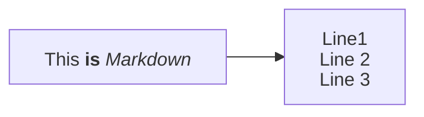

### Direction
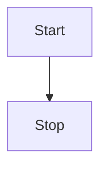
- TB - Top to bottom
- TD - Top-down/ same as top to bottom
- BT - Bottom to top
- RL - Right to left
- LR - Left to right

One-line forms (header `flowchart LR`):

- A node with round edges: `id1(This is the text in the box)`
- A stadium-shaped node: `id1([This is the text in the box])`
- A node in a subroutine shape: `id1[[This is the text in the box]]`
- A node in a cylindrical shape: `id1[(Database)]`
- A node in the form of a circle: `id1((This is the text in the circle))`

### A node in an asymmetric shape
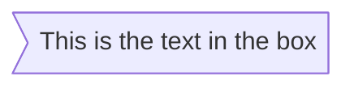
Currently only the shape above is possible and not its mirror. _This might change with future releases._

One-line forms (header `flowchart LR`):

- A node (rhombus): `id1{This is the text in the box}`
- A hexagon node: `id1{{This is the text in the box}}`
- Parallelogram: `id1[/This is the text in the box/]` (`flowchart TD`)
- Parallelogram alt: `id1[\This is the text in the box\]` (`flowchart TD`)
- Trapezoid: `A[/Christmas\]` (`flowchart TD`)
- Trapezoid alt: `B[\Go shopping/]` (`flowchart TD`)
- Double circle: `id1(((This is the text in the circle)))` (`flowchart TD`)

## Expanded Node Shapes in Mermaid Flowcharts (v11.3.0+)
```
A@{ shape: rect }
```

### Complete List of New Shapes
Use as `A@{ shape: <short name or alias> }`.

| Short name | Aliases | Meaning |
|---|---|---|
| `bang` |  | Bang |
| `browser` |  | Browser |
| `bucket` |  | Bucket |
| `notch-rect` | `card`, `notched-rectangle` | Card |
| `cloud` |  | Cloud |
| `hourglass` | `collate` | Collate |
| `bolt` | `com-link`, `lightning-bolt` | Com Link |
| `brace` | `brace-l`, `comment` | Comment |
| `brace-r` |  | Comment Right |
| `braces` |  | Comment with braces on both sides |
| `console` |  | Console |
| `lean-r` | `in-out`, `lean-right` | Data Input/Output |
| `lean-l` | `lean-left`, `out-in` | Data Input/Output |
| `datastore` | `data-store` | Data Store |
| `cyl` | `cylinder`, `database`, `db` | Database |
| `diam` | `decision`, `diamond`, `question` | Decision |
| `delay` | `half-rounded-rectangle` | Delay |
| `h-cyl` | `das`, `horizontal-cylinder` | Direct Access Storage |
| `lin-cyl` | `disk`, `lined-cylinder` | Disk Storage |
| `curv-trap` | `curved-trapezoid`, `display` | Display |
| `div-rect` | `div-proc`, `divided-process`, `divided-rectangle` | Divided Process |
| `doc` | `document` | Document |
| `rounded` | `event` | Event |
| `tri` | `extract`, `triangle` | Extract |
| `folder` | `directory` | Folder |
| `fork` | `join` | Fork/Join |
| `win-pane` | `internal-storage`, `window-pane` | Internal Storage |
| `f-circ` | `filled-circle`, `junction` | Junction |
| `lin-doc` | `lined-document` | Lined Document |
| `lin-rect` | `lin-proc`, `lined-process`, `lined-rectangle`, `shaded-process` | Lined/Shaded Process |
| `notch-pent` | `loop-limit`, `notched-pentagon` | Loop Limit |
| `flip-tri` | `flipped-triangle`, `manual-file` | Manual File |
| `sl-rect` | `manual-input`, `sloped-rectangle` | Manual Input |
| `trap-t` | `inv-trapezoid`, `manual`, `trapezoid-top` | Manual Operation |
| `docs` | `documents`, `st-doc`, `stacked-document` | Multi-Document |
| `st-rect` | `processes`, `procs`, `stacked-rectangle` | Multi-Process |
| `odd` |  | Odd |
| `flag` | `paper-tape` | Paper Tape |
| `person` |  | Person |
| `hex` | `hexagon`, `prepare` | Prepare Conditional |
| `trap-b` | `priority`, `trapezoid`, `trapezoid-bottom` | Priority Action |
| `rect` | `proc`, `process`, `rectangle` | Process |
| `circle` | `circ` | Start |
| `sm-circ` | `small-circle`, `start` | Start |
| `dbl-circ` | `double-circle` | Stop |
| `fr-circ` | `framed-circle`, `stop` | Stop |
| `bow-rect` | `bow-tie-rectangle`, `stored-data` | Stored Data |
| `fr-rect` | `framed-rectangle`, `subproc`, `subprocess`, `subroutine` | Subprocess |
| `cross-circ` | `crossed-circle`, `summary` | Summary |
| `tag-doc` | `tagged-document` | Tagged Document |
| `tag-rect` | `tag-proc`, `tagged-process`, `tagged-rectangle` | Tagged Process |
| `stadium` | `pill`, `terminal` | Terminal Point |
| `text` |  | Text Block |

One-line forms (header `flowchart TD`):

- Icon Shape: `A@{ icon: "fa:user", form: "square", label: "User Icon", pos: "t", h: 60 }`
#### Parameters
- **icon**: The name of the icon from the registered icon pack.
- **form**: Specifies the background shape of the icon. If not defined there will be no background to icon. Options include:
- **label**: The text label associated with the icon. This can be any string. If not defined, no label will be displayed.
- **pos**: The position of the label. If not defined label will default to bottom of icon. Possible values are:
- **h**: The height of the icon. If not defined this will default to 48 which is minimum.

### Image Shape
```
flowchart TD
    A@{ img: "https://example.com/image.png", label: "Image Label", pos: "t", w: 60, h: 60, constraint: "off" }
```
#### Parameters
- **img**: The URL of the image to be displayed.
- **label**: The text label associated with the image. This can be any string. If not defined, no label will be displayed.
- **pos**: The position of the label. If not defined, the label will default to the bottom of the image. Possible values are:
- **w**: The width of the image. If not defined, this will default to the natural width of the image.
- **h**: The height of the image. If not defined, this will default to the natural height of the image.
- **constraint**: Determines if the image should constrain the node size.

One-line forms (header `flowchart LR`):

- A link with arrow head: `A-->B`
- An open link: `A --- B`

### Text on links
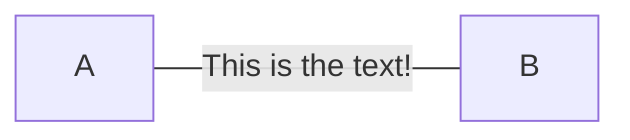

### A link with arrow head and text
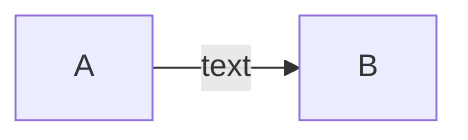

One-line forms (header `flowchart LR`):

- Dotted link: `A-.->B;`
- Dotted link with text: `A-. text .-> B`
- Thick link: `A ==> B`
- Thick link with text: `A == text ==> B`
- An invisible link: `A ~~~ B`

### Chaining of links
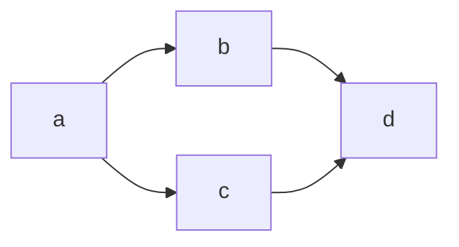

One-line forms (header `flowchart LR`):

- Attaching an ID to Edges: `A e1@--> B`

### Using classDef Statements for Animations
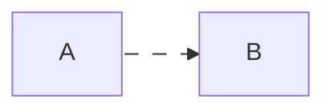
- `e1@-->` creates an edge with ID `e1`.
- `classDef animate` defines a class named `animate` with styling and animation properties.
- `class e1 animate` applies the `animate` class to the edge `e1`.

## New arrow types
- circle edge
- cross edge

One-line forms (header `flowchart LR`):

- Circle edge example: `A --o B`
- Cross edge example: `A --x B`

## Multi directional arrows
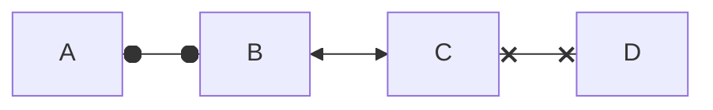

### Minimum length of a link
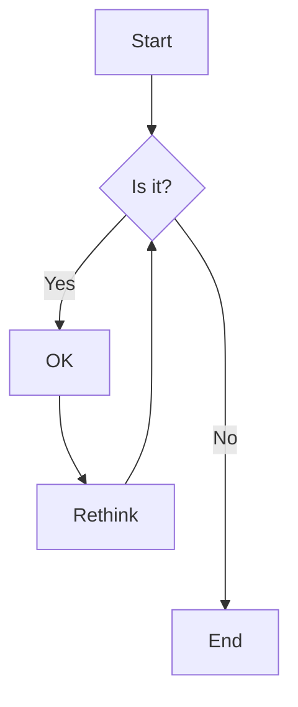
When the link label is written in the middle of the link, the extra dashes must be added on the right side of the link.

| Length | 1 | 2 | 3 |
|---|---|---|---|
| Normal | `---` | `----` | `-----` |
| Normal with arrow | `-->` | `--->` | `---->` |
| Thick | `===` | `====` | `=====` |
| Thick with arrow | `==>` | `===>` | `====>` |
| Dotted | `-.-` | `-..-` | `-...-` |
| Dotted with arrow | `-.->` | `-..->` | `-...->` |

One-line forms (header `flowchart LR`):

- Special characters that break syntax: `id1["This is the (text) in the box"]`
- Entity codes to escape characters: `A["A double quote:#quot;"] --> B["A dec char:#9829;"]`

## Subgraphs
```
subgraph title
    graph definition
end
```

### flowcharts
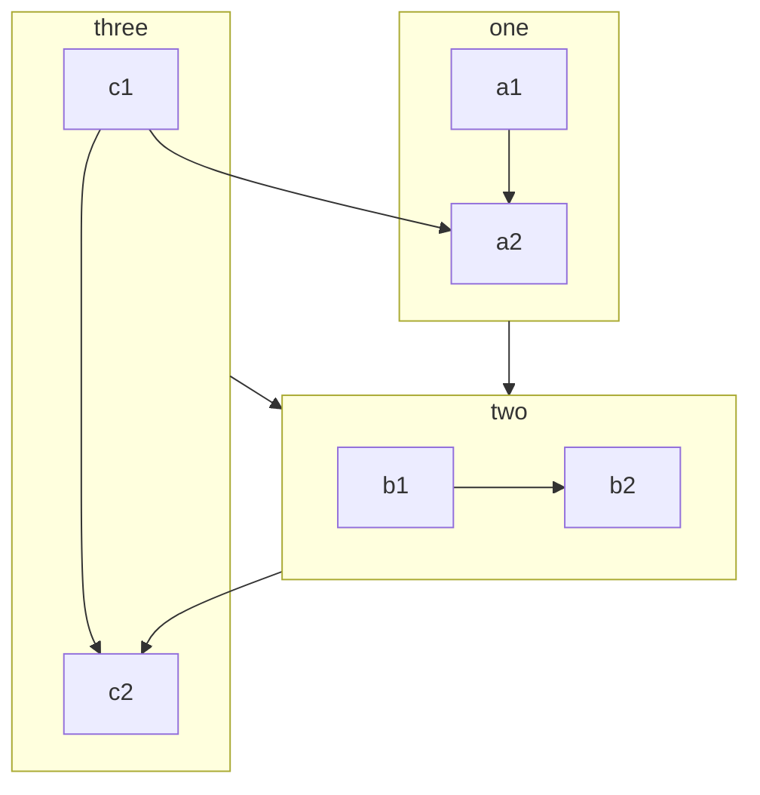
#### Limitation
If any of a subgraph's nodes are linked to the outside, subgraph direction will be ignored.

### Collapsible subgraphs (v11.17.0+)
- Its internal nodes are hidden and it is drawn as a single node carrying the subgraph's title.
- Edges that cross the subgraph boundary are **redirected to the collapsed node**.
- Edges that are entirely internal to the collapsed subgraph are dropped (they would otherwise become self-loops on the collapsed node).
- For nested subgraphs, a collapse resolves to the **outermost** collapsed ancestor, so an edge pointing at a deeply nested node lands on the outermost collapsed group.

## Markdown Strings
- For bold text, use double asterisks (`**`) before and after the text.
- For italics, use single asterisks (`*`) before and after the text.
- With traditional strings, you needed to add ` ` tags for text to wrap in nodes.

## Interaction
```
click nodeId callback
click nodeId call callback()
```
- nodeId is the id of the node
- callback is the name of a javascript function defined on the page displaying the graph, the function will be called with the nodeId as parameter.

### Comments
Comments can be entered within a flow diagram, which will be ignored by the parser.

### Styling links
It is possible to style links. For instance, you might want to style a link that is going backwards in the flow.
```
linkStyle 3 stroke:#ff3,stroke-width:4px,color:red;
```

### Styling line curves
- Change the curve style of all the lines
- Change the curve style of a particular line
#### Edge level curve style using Edge IDs (v11.10.0+)
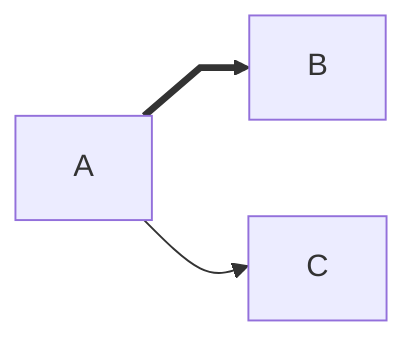

### Styling a node
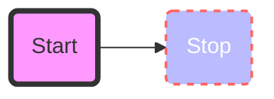
#### Classes
```
    classDef className fill:#f9f,stroke:#333,stroke-width:4px;
```

### Default class
```
    classDef default fill:#f9f,stroke:#333,stroke-width:4px;
```

### Custom icons
```
flowchart TD
    B[fa:fa-twitter] %% standard icon
    B-->E(fak:fa-custom-icon-name) %% custom icon
```

## Graph declarations with spaces between vertices and link and without semicolon
- In graph declarations, the statements also can now end without a semicolon. After release 0.2.16, ending a graph statement with semicolon is just optional.
- A single space is allowed between vertices and the link. However there should not be any space between a vertex and its text and a link and its text.

### Renderer
To use the classic Dagre layout instead:
```
config:
  layout: dagre
```
The `defaultRenderer` option of the `flowchart`, `class` and `state` config sections was removed in v12.
