> Mermaid v12.1.0 · source: packages/mermaid/src/docs/syntax/gitgraph.md · header: `gitGraph` · since 8.0.0

# GitGraph Diagrams

- _commit_ : Representing a new commit on the current branch.
- _branch_ : To create & switch to a new branch, setting it as the current branch.
- _checkout_ : To checking out an existing branch and setting it as the current branch.
- _merge_ : To merge an existing branch onto the current branch.

With the help of these key git commands, you will be able to draw a gitgraph in Mermaid very easily and quickly.

**NOTE**: `checkout` and `switch` can be used interchangeably.

## Syntax
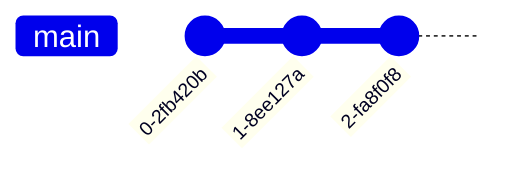

### Adding custom commit id
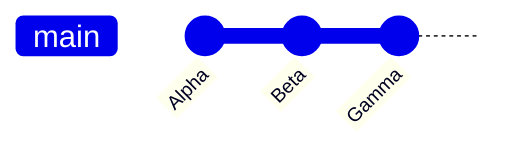

### Modifying commit type
- `NORMAL` : Default commit type. Represented by a solid circle in the diagram
- `REVERSE` : To emphasize a commit as a reverse commit. Represented by a crossed solid circle in the diagram.
- `HIGHLIGHT` : To highlight a particular commit in the diagram. Represented by a filled rectangle in the diagram.

For a given commit you may specify its type at the time of declaring it using the `type` attribute, followed by `:` and the required type option discussed above.

NOTE: If no commit type is specified, `NORMAL` is picked as default.
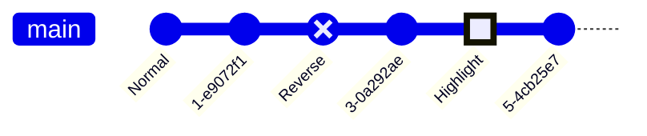

### Adding Tags
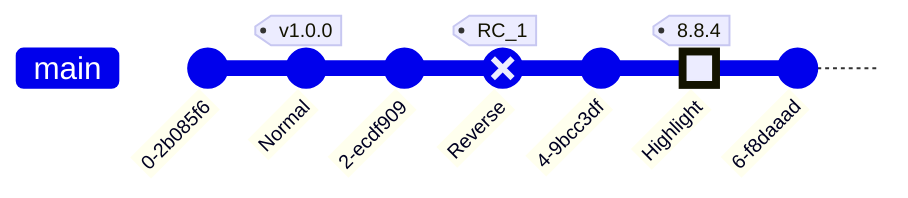

### Create a new branch
In Mermaid, in-order to create a new branch, you make use of the `branch` keyword. You also need to provide a name of the new branch.
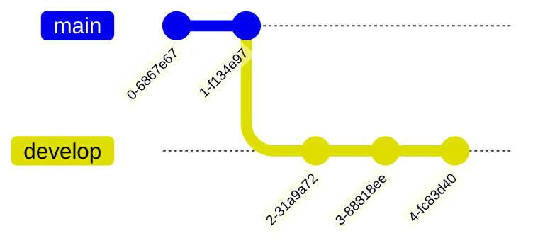

### Merging two branches
In Mermaid, in order to merge or join to an existing branch, you make use of the `merge` keyword.

- `id`--> To override the default ID with custom ID
- `tag`--> To add a custom tag to your merge commit
- `type`--> To override the default shape of merge commit. Here you can use other commit type mentioned earlier.

### Cherry Pick commit from another branch
To use the `cherry-pick` keyword, you must specify the id using the `id` attribute, followed by `:` and your desired commit id within a `""` quote.

- You need to provide the `id` for an existing commit to be cherry-picked. If given commit id does not exist it will result in an error.
- The given commit must not exist on the current branch. The cherry-picked commit must always be a different branch than the current branch.
- Current branch must have at least one commit, before you can cherry-pick, otherwise it will cause an error is throw.
- When cherry-picking a merge commit, providing a parent commit ID is mandatory. If the parent attribute is omitted or an invalid parent commit ID is provided, an error will be thrown.
- The specified parent commit must be an immediate parent of the merge commit being cherry-picked.
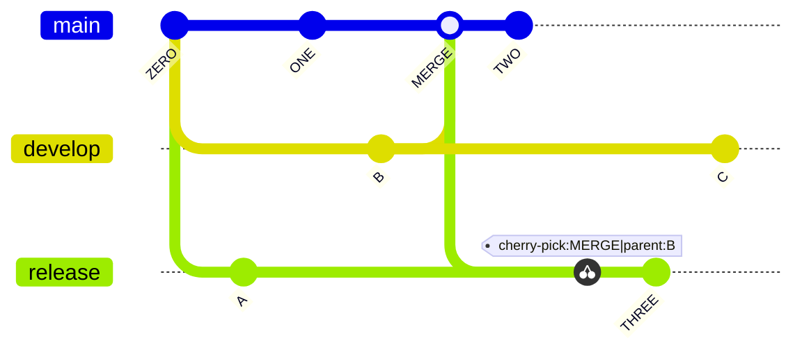

## GitGraph specific configuration options
- `showBranches` : Boolean, default is `true`. If set to `false`, the branches are not shown in the diagram.
- `showCommitLabel` : Boolean, default is `true`. If set to `false`, the commit labels are not shown in the diagram.
- `mainBranchName` : String, default is `main`. The name of the default/root branch.
- `mainBranchOrder` : Position of the main branch in the list of branches. default is `0`, meaning, by default `main` branch is the first in the order.
- `parallelCommits`: Boolean, default is `false`. If set to `true`, commits x distance away from the parent are shown at the same level in the diagram.

## Commit labels Layout: Rotated or Horizontal
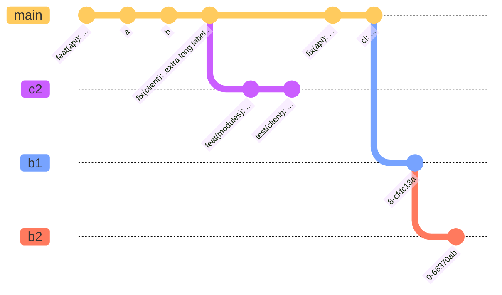

## Customizing branch ordering
- Main branch is always shown first as it has default order value of `0`. (unless its order is modified and changed from `0` using the `mainBranchOrder` keyword in the config)
- Next, All branches without an `order` are shown in the order of their appearance in the diagram code.
- Next, All branches with an `order` are shown in the order of their `order` value.

To fully control the order of all the branches, you must define `order` for all the branches.
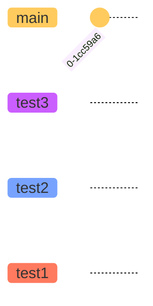
NOTE: Because we have overridden the `mainBranchOrder` to `2`, the `main` branch is not drawn in the beginning, instead follows the ordering.

### Temporal Commits (default, `parallelCommits: false`)
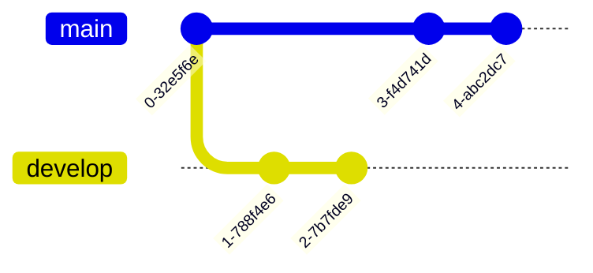

## Themes
- `redux-color` (the default)
- `redux-dark-color`
- `redux`
- `redux-dark`
- `default`
- `neutral`
- `dark`
- `forest`
- `neo`
- `neo-dark`
- `base`

**NOTE**: To change theme you can either use the `initialize` call or _directives_.

### Customizing branch colors
NOTE: Default values for these theme variables are picked from the selected theme.

### Customizing Commit Label Font Size
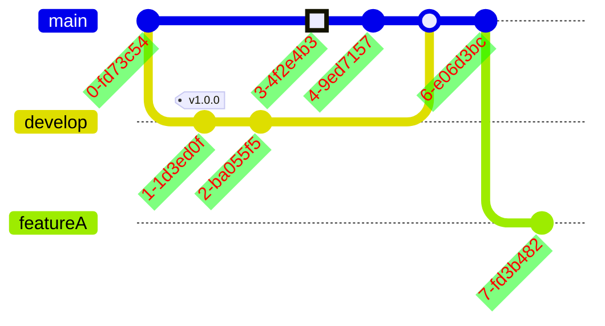

### Customizing Tag colors
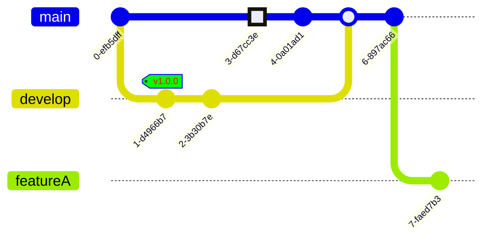
