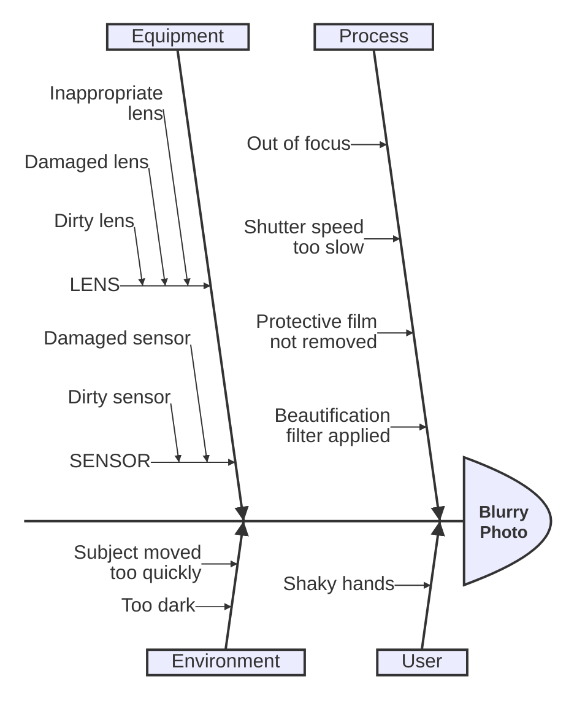

> Mermaid v12.1.0 · source: packages/mermaid/src/docs/syntax/ishikawa.md · header: `ishikawa-beta` · since 11.13.0 · beta (header needs the `-beta` suffix)

# Ishikawa diagram (v11.12.3+)

## Pitfalls

- This is a new diagram type in Mermaid. Its syntax may evolve in future versions.

## Syntax

- The first line is the event (problem) of the diagram.
- Subsequent lines are causes of the event.
- "Fishbone" structure is indicated by indentation.
