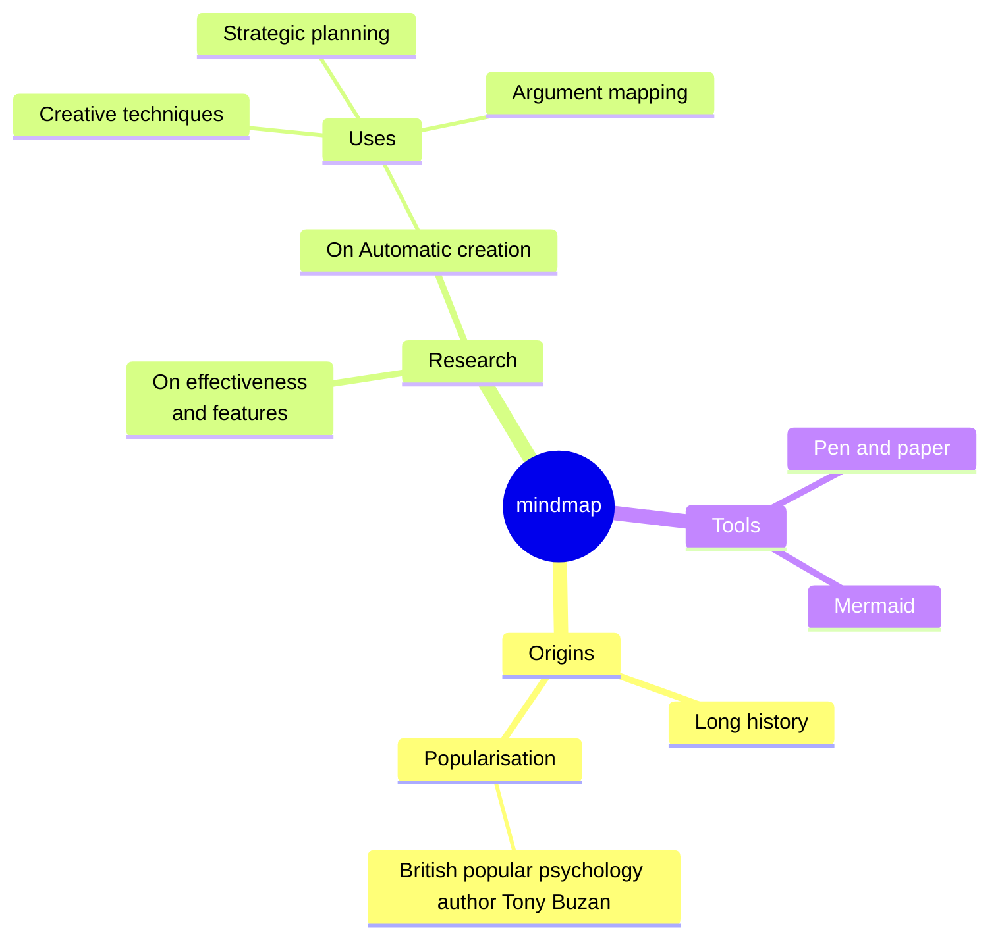
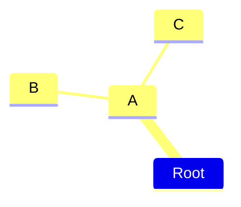
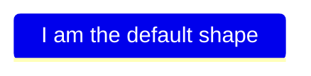
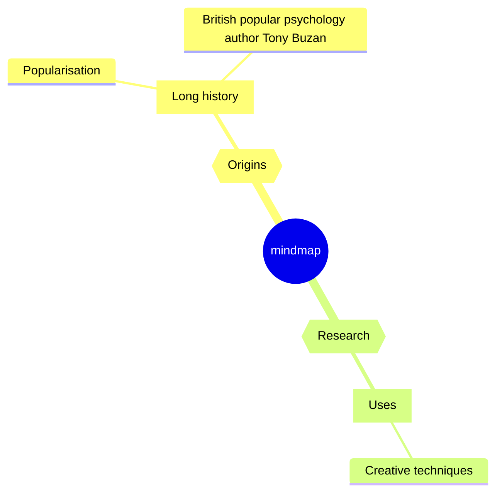
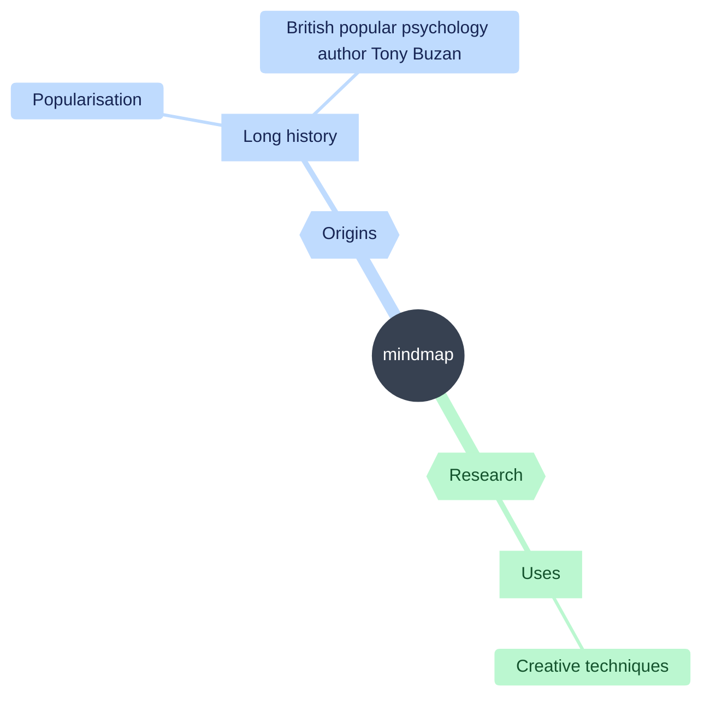
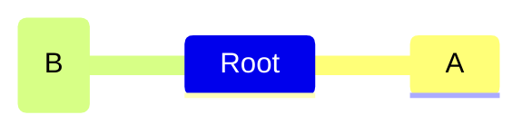
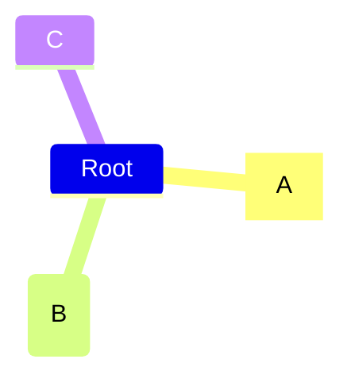
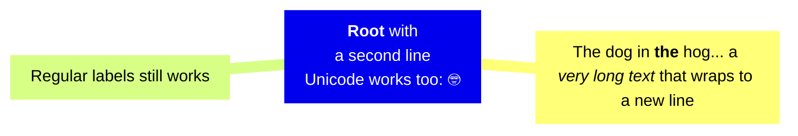

> Mermaid v12.1.0 · source: packages/mermaid/src/docs/syntax/mindmap.md · header: `mindmap` · since 9.3.0

# Mindmap

### An example of a mindmap.


## Syntax
The syntax for creating Mindmaps is simple and relies on indentation for setting the levels in the hierarchy.

In the following example you can see how there are 3 different levels. One with starting at the left of the text and another level with two rows starting at the same column, defining the node A.
```
mindmap
    Root
        A
            B
            C
```
In summary is a simple text outline where there is one node at the root level called `Root` which has one child `A`. `A` in turn has two children `B`and `C`. In the diagram below we can see this rendered as a mindmap.

In this way we can use a text outline to generate a hierarchical mindmap.

## Different shapes
Mermaid mindmaps can show nodes using different shapes. When specifying a shape for a node the syntax is similar to flowchart nodes, with an id followed by the shape definition and with the text within the shape delimiters.

One-line forms (header `mindmap`):

- Square: `id[I am a square]`
- Rounded square: `id(I am a rounded square)`
- Circle: `id((I am a circle))`
- Bang: `id))I am a bang((`
- Cloud: `id)I am a cloud(`
- Hexagon: `id{{I am a hexagon}}`

### Default

More shapes will be added, beginning with the shapes available in flowcharts.

## Coloring by depth (v<MERMAID_RELEASE_VERSION>+)
By default, mindmaps use a different color for each top-level branch. Descendants inherit their branch's color. Set `mindmap.colorBy` to `depth` to give all nodes at the same hierarchy level the same color, across every branch:

Depth counts parent-child relationships, not spaces: the root has depth 0, its children have depth 1, and their children have depth 2. Uneven indentation does not change the color of nodes that share a depth.

With the classic look, the root uses `git0` for its background and `gitBranchLabel0` for its label (`redux` themes color HTML labels with `nodeBorder` instead).

To choose the color of each level, set those variables with the `base` theme and pick contrasting background and label colors. The `neo` look colors the root label with `cScaleLabel0`, so set it too.

Depth mode uses the same theme styles as branch coloring and only changes which nodes share a color. In the `neo` look, some themes use one background for every node in both modes:

- Themes with `useGradient` enabled paint every node, including the root, with `mainBkg`. It is on by default in `base`, `dark`, `forest`, `neo`, `neo-dark` and `neutral`.
- `neutral`, `redux` and `redux-dark` paint every node below the root with `mainBkg` even without the gradient, and use one label color for all of them.

In the `neo` look, the root label uses `cScaleLabel0` (`cScaleLabel1` in `neutral`, `nodeBorder` in `redux` themes). Edges keep their depth colors, except in `neo-dark` and the `redux` themes.

Set `mindmap.colorBy` to `branch` (the default) to restore branch coloring.

## Icons
As with flowcharts you can add icons to your nodes but with an updated syntax.


## Classes
Again the syntax for adding classes is similar to flowcharts. You can add classes using a triple colon following a number of css classes separated by space.

_These classes need to be supplied by the site administrator._

## Unclear indentation
The actual indentation does not really matter only compared with the previous rows. If we take the previous example and disrupt it a little we can see how the calculations are performed.

This outline is unclear as `B` clearly is a child of `A` but when we move on to `C` the clarity is lost. `C` is neither a child of `B` with a higher indentation nor does it have the same indentation as `B`.

## Markdown Strings
The "Markdown Strings" feature enhances mind maps by offering a more versatile string type, which supports text formatting options such as bold and italics, and automatically wraps text within labels.

Formatting:

- For bold text, use double asterisks ** before and after the text.
- For italics, use single asterisks * before and after the text.
- With traditional strings, you needed to add tags for text to wrap in nodes.

## Integrating with your library/website.
Mindmap uses the experimental lazy loading & async rendering features which could change in the future. From version 9.4.0 this diagram is included in mermaid but use lazy loading in order to keep the size of mermaid down.

You can still use the pre 9.4.0 method to add mermaid with mindmaps to a web page:

From version 9.4.0 you can simplify this code to:

You can also refer the implementation in the live editor to see how the async loading is done.

## Layouts
Mermaid also supports a Tidy Tree layout for mindmaps.
```
---
config:
  layout: tidy-tree
---
mindmap
root((mindmap is a long thing))
  A
  B
  C
  D
```
Instructions to add and register tidy-tree layout are present in Tidy Tree Configuration
