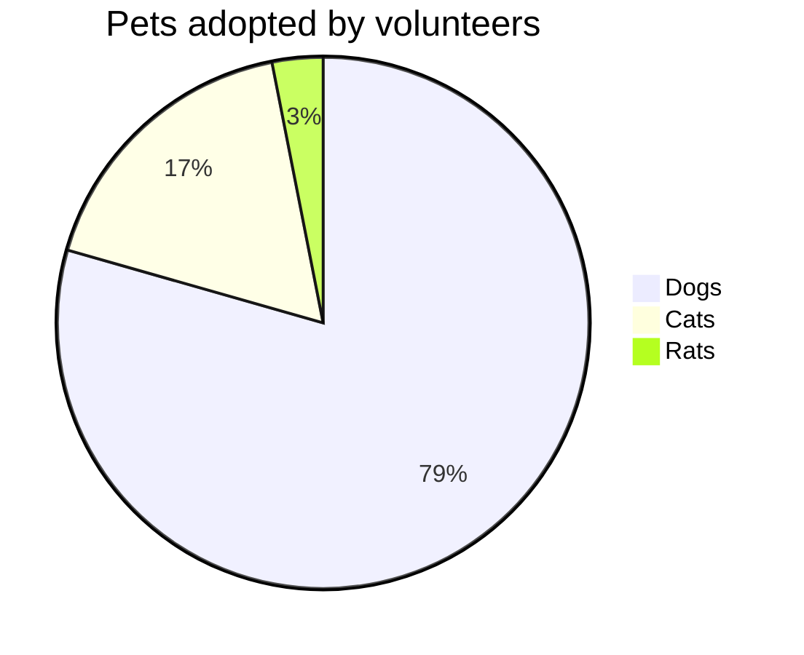
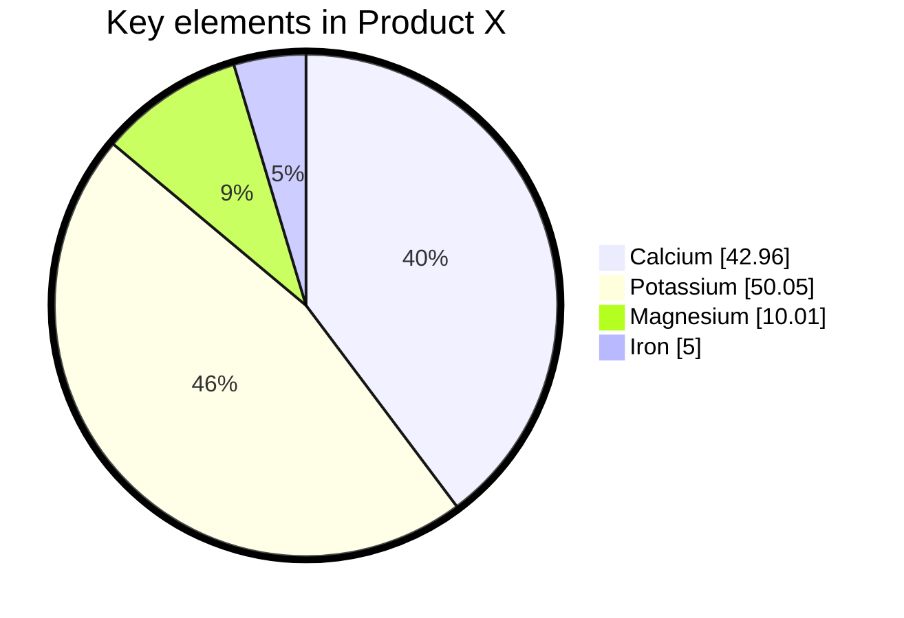

> Mermaid v12.1.0 · source: packages/mermaid/src/docs/syntax/pie.md · header: `pie` · since 8.0.0

# Pie chart diagrams

## Pitfalls

- Pie chart values must be **positive numbers greater than zero**. **Negative values are not allowed** and will result in an error.

## Syntax
Drawing a pie chart is really simple in mermaid.

- Start with `pie` keyword to begin the diagram
  - `showData` to render the actual data values after the legend text. This is **_OPTIONAL_**
- Followed by `title` keyword and its value in string to give a title to the pie-chart. This is **_OPTIONAL_**
- Followed by dataSet. Pie slices will be ordered clockwise in the same order as the labels.
  - `label` for a section in the pie diagram within `" "` quotes.
  - Followed by `:` colon as separator
  - Followed by `positive numeric value` (supported up to two decimal places)

## Donut chart diagram (v11.16.0+)
By setting `donutHole` parameter on config, Mermaid can render Donut Chart Diagram.

## Legend Position (v11.16.0+)
By setting `legendPosition` parameter on config, you can set where the legend is positioned.

## Highlight Slice (v11.16.0+)
By setting `highlightSlice` parameter on config, you can highlight specific slice. You can also highlight slice by hovering on it.

## Example

## Configuration
Possible pie diagram configuration parameters:

| Parameter | Description | Default value |
|---|---|---|
| `textPosition` | The axial position of the pie slice labels, from 0.0 at the center to 1.0 at the outside edge of the circle. | `0.75` |
| `donutHole` | Donut hole ratio. Valid values are from `0` to `0.9`. | `0` |
| `legendPosition` | Legend's position relative to the chart. Valid values are `top`, `bottom`, `left`, `right`, and `center`. | `right` |
| `highlightSlice` | Highlight specific slice with matching label. Set to 'hover' to highlight hovered slice. |  |
