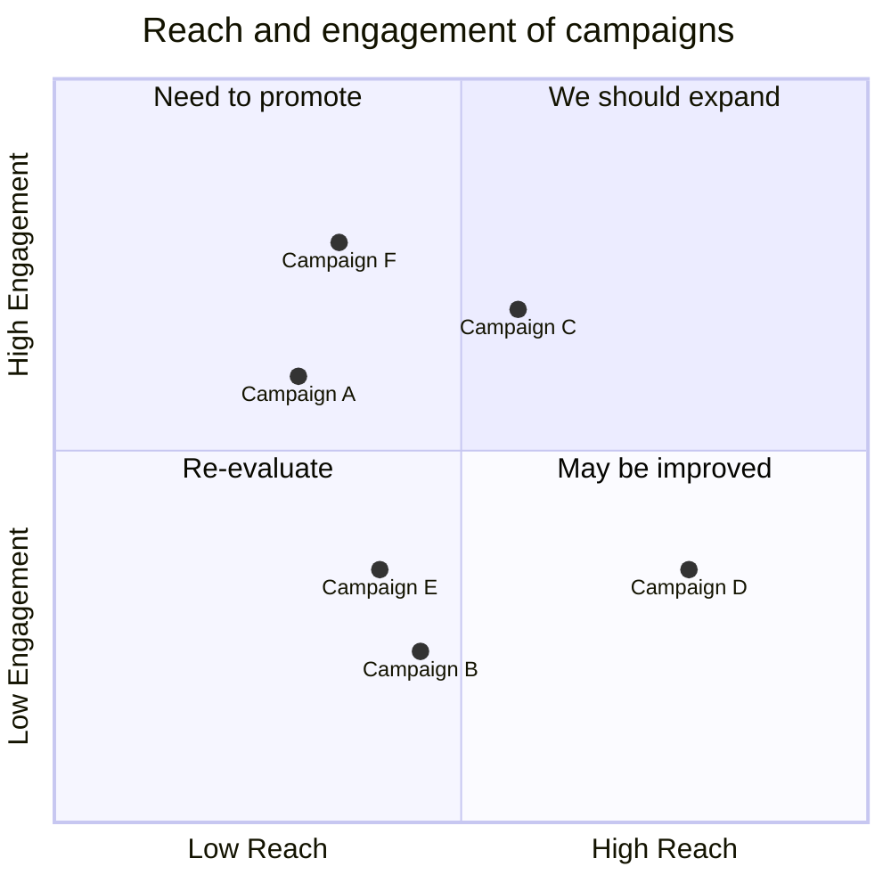
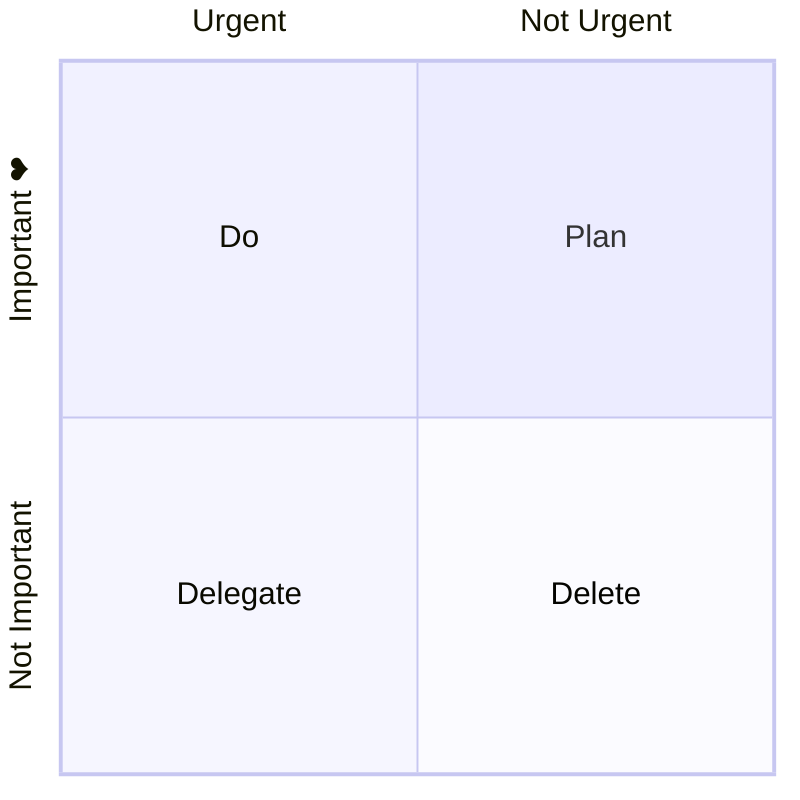
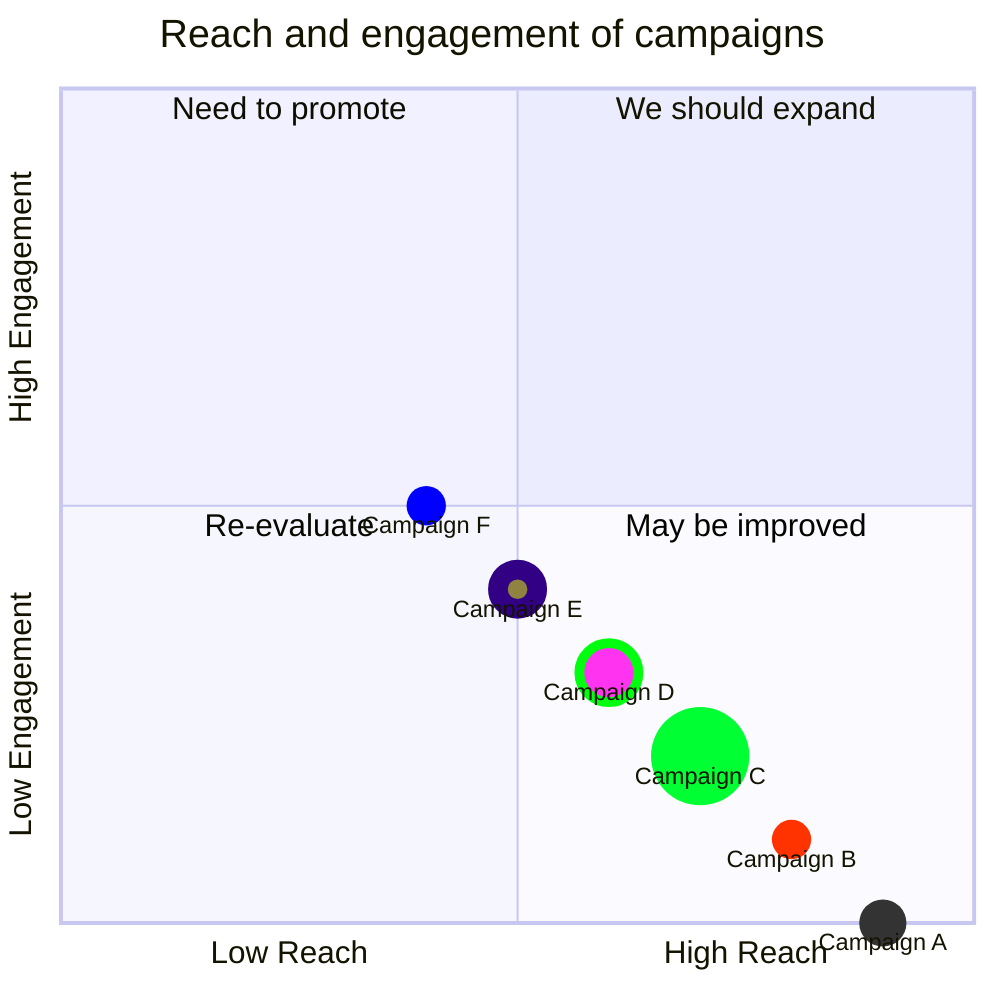

> Mermaid v12.1.0 · source: packages/mermaid/src/docs/syntax/quadrantChart.md · header: `quadrantChart` · since 10.2.0

# Quadrant Chart

## Pitfalls

- If there are no points available in the chart both **axis** text and **quadrant** will be rendered in the center of the respective quadrant.
- For points x and y value min value is 0 and max value is 1.
- **Available styles:.** Order of preference: 1. Direct styles 2. Class styles 3. Theme styles

## Example


### Title
The title is a short description of the chart and it will always render on top of the chart.
#### Example
```
quadrantChart
    title This is a sample example
```

### x-axis
The x-axis determines what text would be displayed in the x-axis. In x-axis there is two part **left** and **right** you can pass **both** or you can pass only **left**.
#### Example
- `x-axis <text> --> <text>` both the left and right axis text will be rendered.
- `x-axis <text>` only the left axis text will be rendered.

### y-axis
The y-axis determines what text would be displayed in the y-axis. In y-axis there is two part **top** and **bottom** you can pass **both** or you can pass only **bottom**.
#### Example
- `y-axis <text> --> <text>` both the bottom and top axis text will be rendered.
- `y-axis <text>` only the bottom axis text will be rendered.

### Quadrants text
The `quadrant-[1,2,3,4]` determine what text would be displayed inside the quadrants.
#### Example
- `quadrant-1 <text>` determine what text will be rendered inside the top right quadrant.
- `quadrant-2 <text>` determine what text will be rendered inside the top left quadrant.
- `quadrant-3 <text>` determine what text will be rendered inside the bottom left quadrant.
- `quadrant-4 <text>` determine what text will be rendered inside the bottom right quadrant.

### Points
Points are used to plot a circle inside the quadrantChart. The syntax is `<text>: [x, y]` here x and y value is in the range 0 - 1.
#### Example
- `Point 1: [0.75, 0.80]` here the Point 1 will be drawn in the top right quadrant.
- `Point 2: [0.35, 0.24]` here the Point 2 will be drawn in the bottom left quadrant.

## Chart Configurations
| Parameter | Description | Default value |
|---|---|---|
| chartWidth | Width of the chart | 500 |
| chartHeight | Height of the chart | 500 |
| titlePadding | Top and Bottom padding of the title | 10 |
| titleFontSize | Title font size | 20 |
| quadrantPadding | Padding outside all the quadrants | 5 |
| quadrantTextTopPadding | Quadrant text top padding when text is drawn on top ( not data points are there) | 5 |
| quadrantLabelFontSize | Quadrant text font size | 16 |
| quadrantInternalBorderStrokeWidth | Border stroke width inside the quadrants | 1 |
| quadrantExternalBorderStrokeWidth | Quadrant external border stroke width | 2 |
| xAxisLabelPadding | Top and bottom padding of x-axis text | 5 |
| xAxisLabelFontSize | X-axis texts font size | 16 |
| xAxisPosition | Position of x-axis (top , bottom) if there are points the x-axis will always be rendered in bottom | 'top' |
| yAxisLabelPadding | Left and Right padding of y-axis text | 5 |
| yAxisLabelFontSize | Y-axis texts font size | 16 |
| yAxisPosition | Position of y-axis (left , right) | 'left' |
| pointTextPadding | Padding between point and the below text | 5 |
| pointLabelFontSize | Point text font size | 12 |
| pointRadius | Radius of the point to be drawn | 5 |

## Chart Theme Variables
| Parameter | Description |
|---|---|
| quadrant1Fill | Fill color of the top right quadrant |
| quadrant2Fill | Fill color of the top left quadrant |
| quadrant3Fill | Fill color of the bottom left quadrant |
| quadrant4Fill | Fill color of the bottom right quadrant |
| quadrant1TextFill | Text color of the top right quadrant |
| quadrant2TextFill | Text color of the top left quadrant |
| quadrant3TextFill | Text color of the bottom left quadrant |
| quadrant4TextFill | Text color of the bottom right quadrant |
| quadrantPointFill | Points fill color |
| quadrantPointTextFill | Points text color |
| quadrantXAxisTextFill | X-axis text color |
| quadrantYAxisTextFill | Y-axis text color |
| quadrantInternalBorderStrokeFill | Quadrants inner border color |
| quadrantExternalBorderStrokeFill | Quadrants outer border color |
| quadrantTitleFill | Title color |

## Example on config and theme


### Point styling
Points can either be styled directly or with defined shared classes

- Direct styling
- Classes styling
#### Available styles:
| Parameter | Description |
|---|---|
| color | Fill color of the point |
| radius | Radius of the point |
| stroke-width | Border width of the point |
| stroke-color | Border color of the point (useless when stroke-width is not specified) |

## Example on styling

