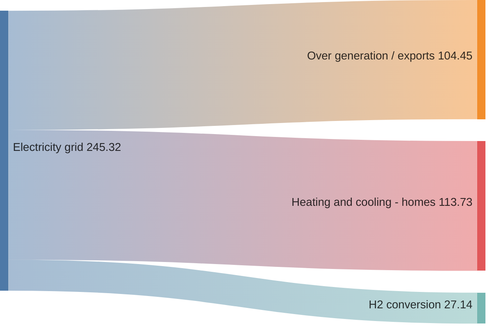
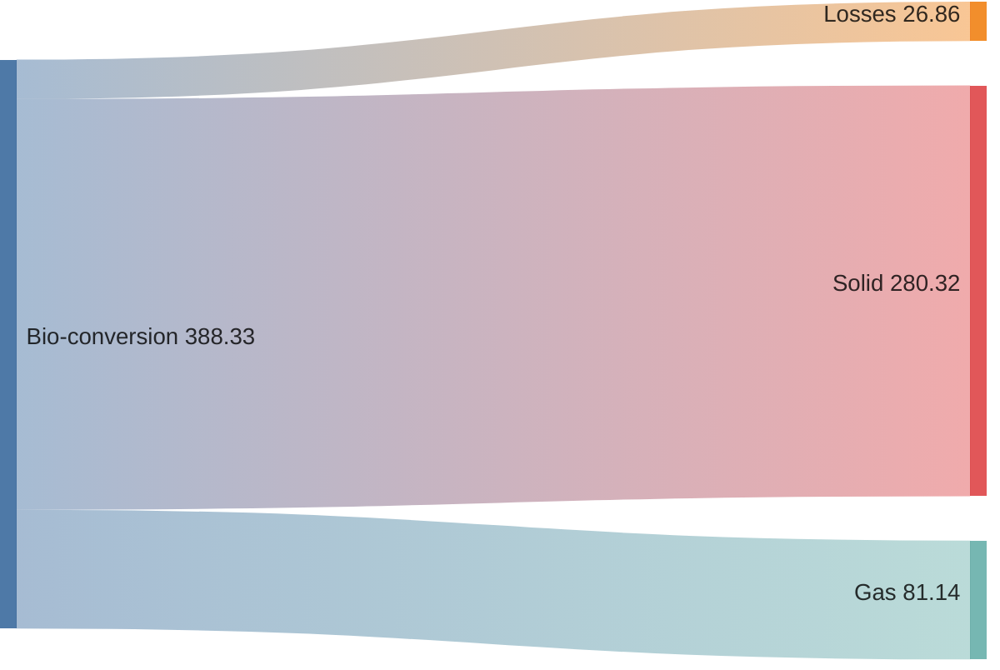
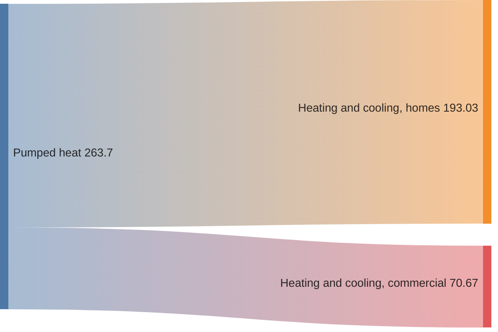
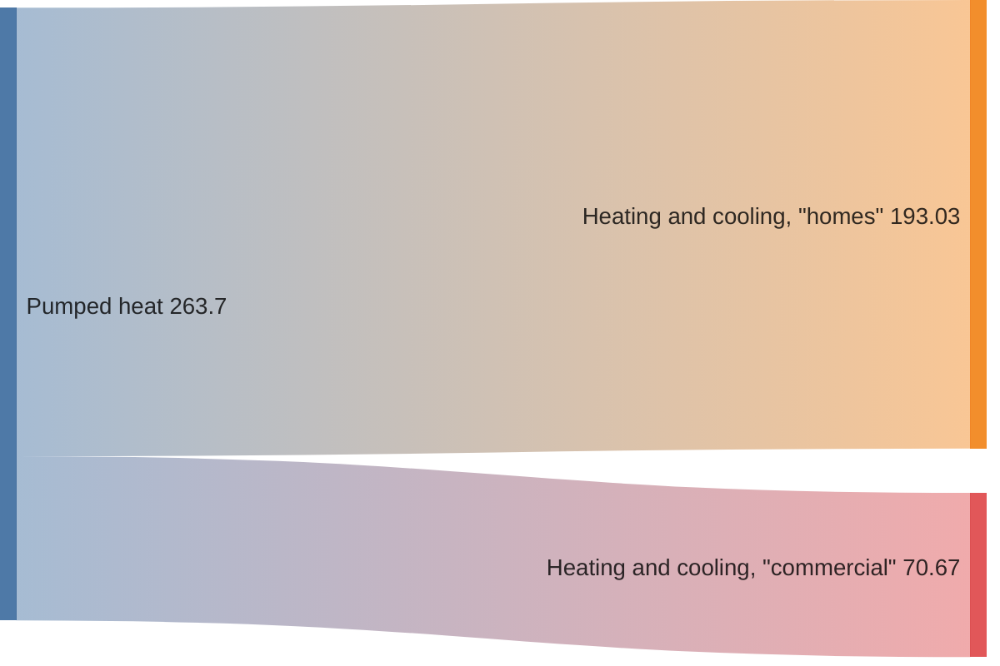
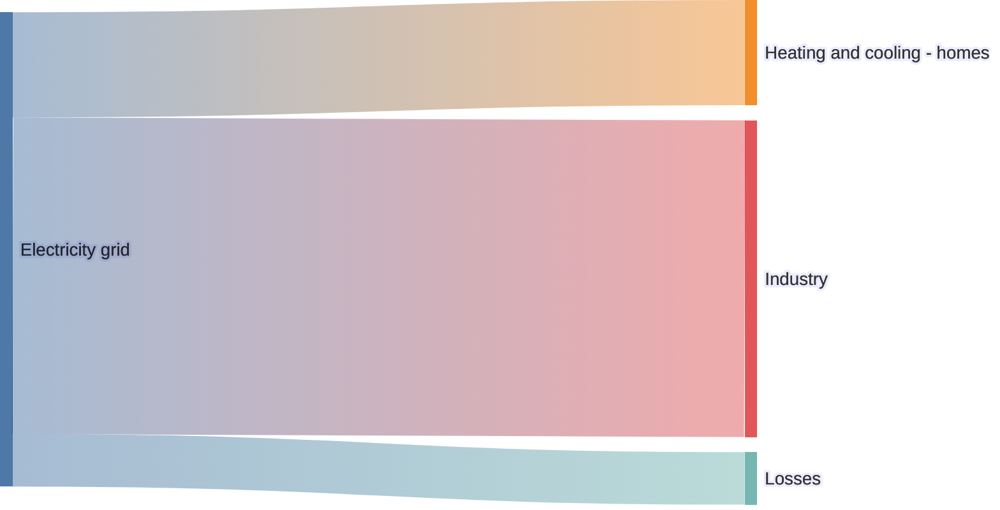
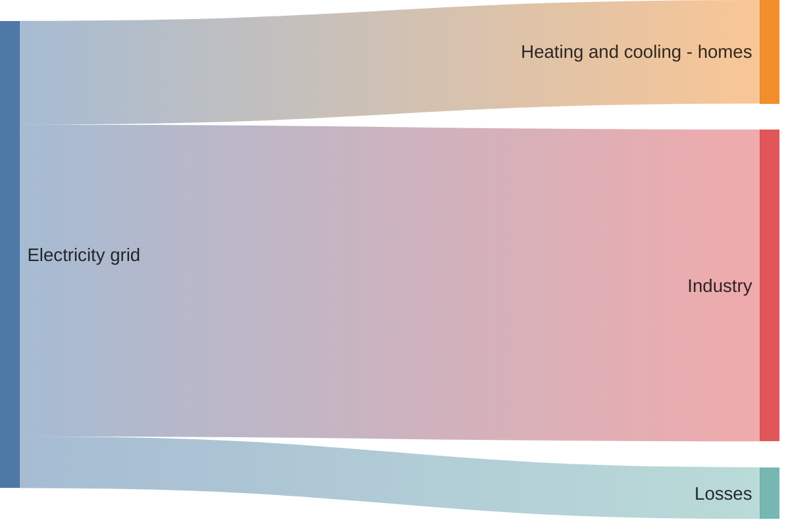
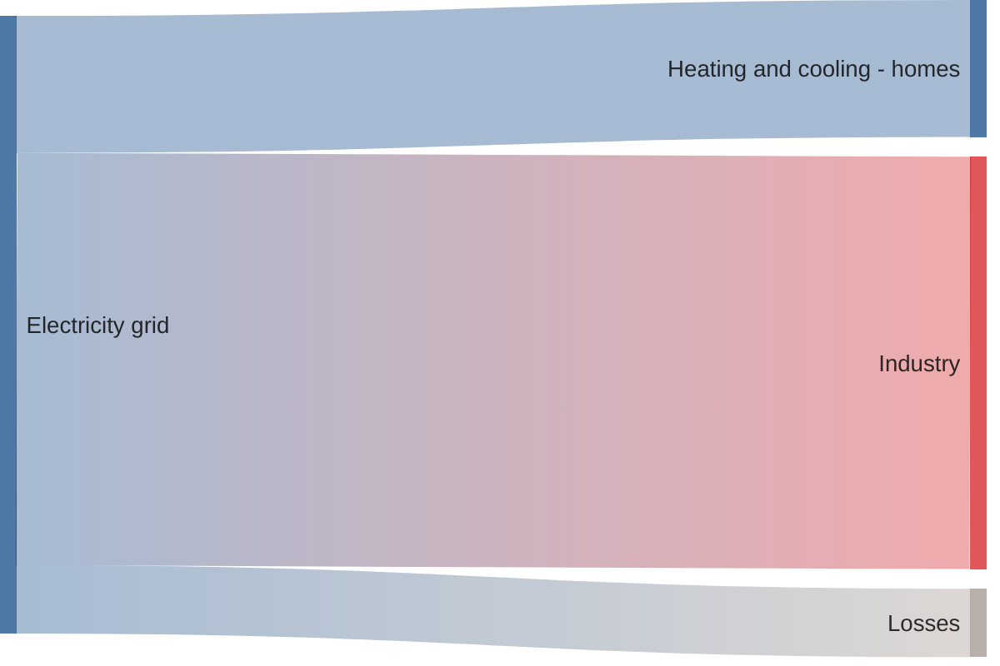

> Mermaid v12.1.0 · source: packages/mermaid/src/docs/syntax/sankey.md · header: `sankey` · since 10.3.0

# Sankey diagram (v10.3.0+)

## Pitfalls

- This is an experimental diagram. Its syntax are very close to plain CSV, but it is to be extended in the nearest future.

## Example
This example taken from observable. It may be rendered a little bit differently, though, in terms of size and colors.

## Syntax
The idea behind syntax is that a user types `sankey` keyword first, then pastes raw CSV below and get the result.

It implements CSV standard as described here with subtle **differences**:

- CSV must contain **3 columns only**
- It is **allowed** to have **empty lines** without comma separators for visual purposes

### Basic
It is implied that 3 columns inside CSV should represent `source`, `target` and `value` accordingly:

### Empty Lines
CSV does not support empty lines without comma delimiters by default. But you can add them if needed:

### Commas
If you need to have a comma, wrap it in double quotes:

### Double Quotes
If you need to have double quote, put a pair of them inside quoted string:

## Configuration
You can customize link colors, node alignments and diagram dimensions.

### Links Coloring
You can adjust links' color by setting `linkColor` to one of those:

- `source` - link will be of a source node color
- `target` - link will be of a target node color
- `gradient` - link color will be smoothly transient between source and target node colors
- hex code of color, like `#a1a1a1`

### Node Alignment
Graph layout can be changed by setting `nodeAlignment` to:

- `justify`
- `center`
- `left`
- `right`

### Label Style (v11.15.0+)
You can change how node labels are rendered by setting `labelStyle`:

- `legacy` (default) - plain text labels, positioned based on node x-coordinate
- `outlined` - labels with a background stroke for improved readability, positioned based on node layer relative to the central node

### Node Width and Padding (v11.15.0+)
You can customize the node dimensions:

- `nodeWidth` - width of the node rectangles in pixels (default: `10`)
- `nodePadding` - vertical padding between nodes in pixels (default: `12`)

### Custom Node Colors (v11.15.0+)
You can assign specific colors to nodes using the `nodeColors` map. Nodes not listed will use the default color scheme. Values must be valid CSS colors (hex, `rgb()`, `hsl()`, or named colors).

