> Mermaid v12.1.0 · source: packages/mermaid/src/docs/syntax/sequenceDiagram.md · header: `sequenceDiagram` · since 8.0.0

# Sequence diagrams

## Pitfalls

- **Grouping / Box.** **Hex colors** (e.g., `#ff0000`) are currently **not supported** as the `#` character is interpreted as comment syntax.
- A note on nodes, the word "end" could potentially break the diagram, due to the way that the mermaid language is scripted. If unavoidable, one must use parentheses(), quotation marks "", or brackets {},[], to enclose the word "end". i.e : (end), [end], {end}.
- **Grouping / Box.** For colored boxes, the color value must be placed **before** the optional description.
- Put `%%` comments on their own line. In message text `;` ends the statement (write `#59;`) and `#` starts an entity code (write `#35;`).

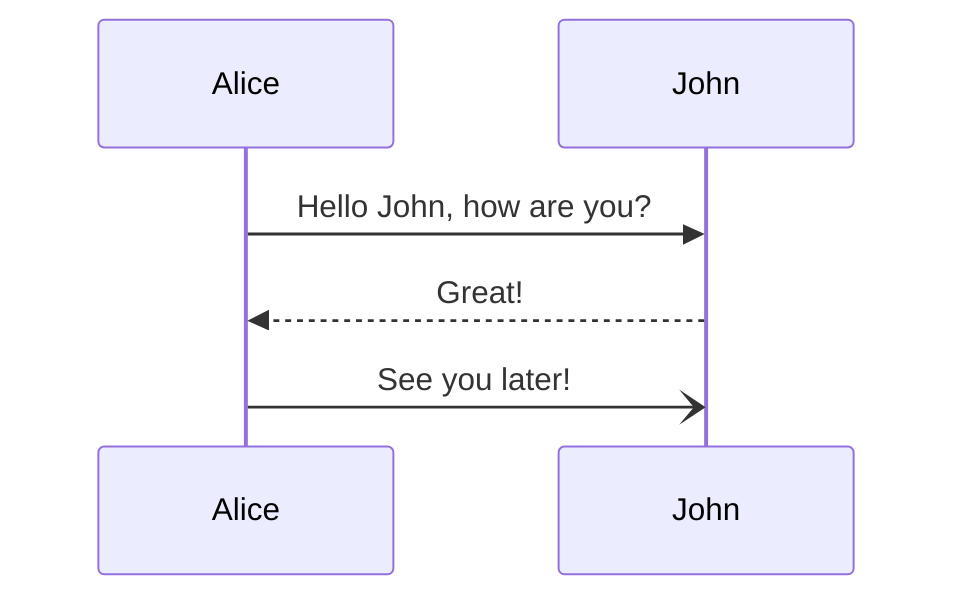

### Participants
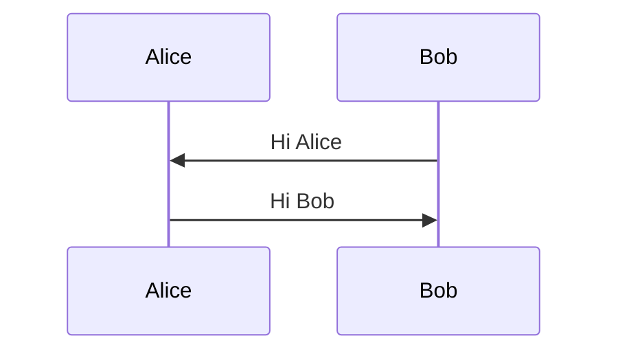

### Actors
If you specifically want to use the actor symbol instead of a rectangle with text you can do so by using actor statements as per below.
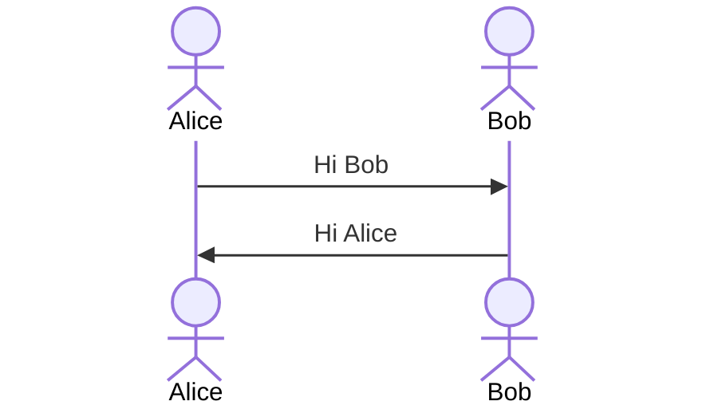

### Boundary
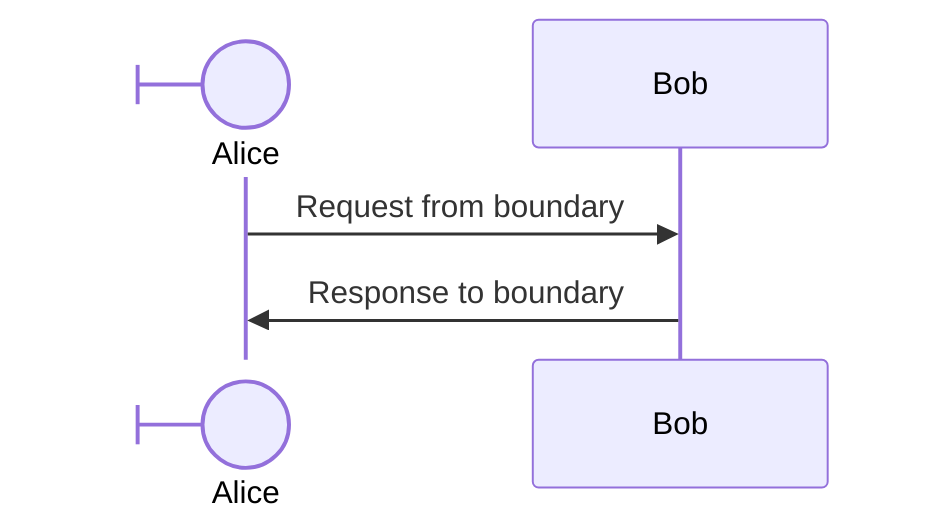
#### External Alias Syntax
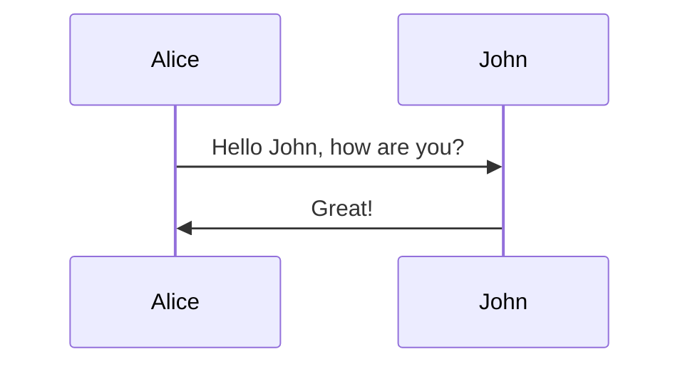
#### Inline Alias Syntax
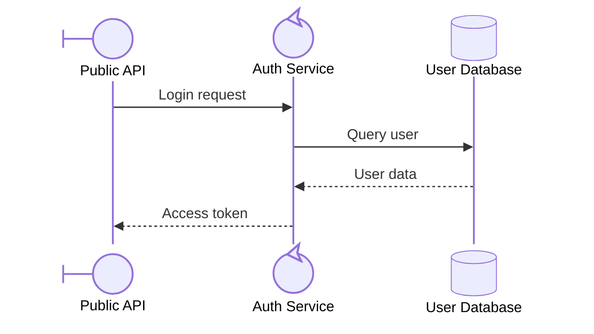
#### Alias Precedence
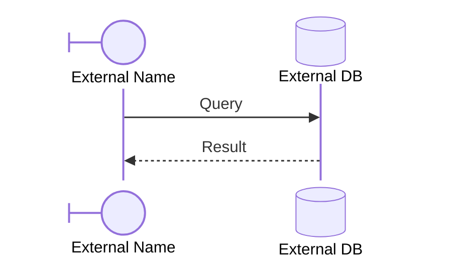

### Actor Creation and Destruction (v10.3.0+)
```
create participant B
A --> B: Hello
```
Create directives support actor/participant distinction and aliases.

### Grouping / Box
```
box transparent Aqua
... actors ...
end
```

## Messages
```
[Actor][Arrow][Actor]:Message text
```
#### Supported Arrow Types
| Type | Description |
|---|---|
| `->` | Solid line without arrow |
| `-->` | Dotted line without arrow |
| `->>` | Solid line with arrowhead |
| `-->>` | Dotted line with arrowhead |
| `<<->>` | Solid line with bidirectional arrowheads (v11.0.0+) |
| `<<-->>` | Dotted line with bidirectional arrowheads (v11.0.0+) |
| `-x` | Solid line with a cross at the end |
| `--x` | Dotted line with a cross at the end |
| `-)` | Solid line with an open arrow at the end (async) |
| `--)` | Dotted line with a open arrow at the end (async) |

| Type | Description |
|---|---|
| `-\|\` | Solid line with top half arrowhead |
| `--\|\` | Dotted line with top half arrowhead |
| `-\|/` | Solid line with bottom half arrowhead |
| `--\|/` | Dotted line with bottom half arrowhead |
| `/\|-` | Solid line with reverse top half arrowhead |
| `/\|--` | Dotted line with reverse top half arrowhead |
| `\-` | Solid line with reverse bottom half arrowhead |
| `\--` | Dotted line with reverse bottom half arrowhead |
| `-\\` | Solid line with top stick half arrowhead |
| `--\\` | Dotted line with top stick half arrowhead |
| `-//` | Solid line with bottom stick half arrowhead |
| `--//` | Dotted line with bottom stick half arrowhead |
| `//-` | Solid line with reverse top stick half arrowhead |
| `//--` | Dotted line with reverse top stick half arrowhead |
| `\-` | Solid line with reverse bottom stick half arrowhead |
| `\--` | Dotted line with reverse bottom stick half arrowhead |
#### Basic Syntax
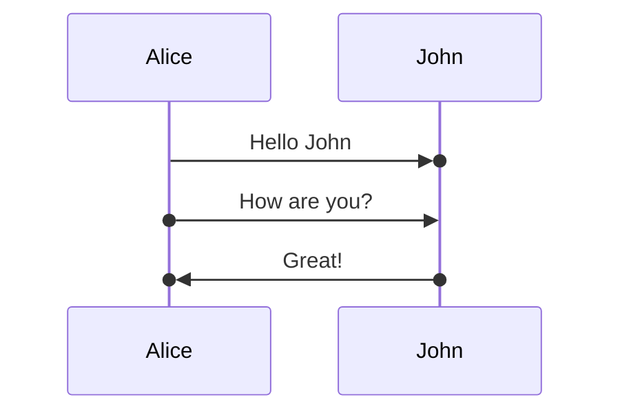

## Activations
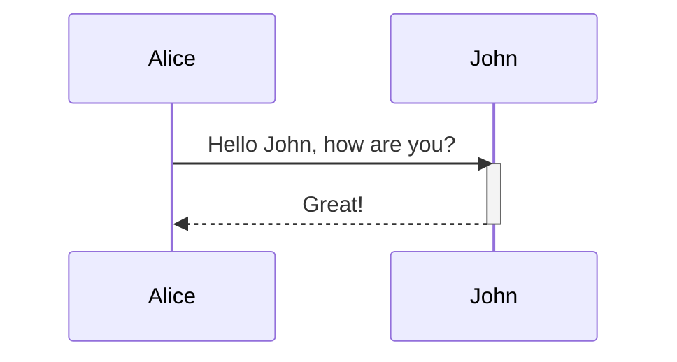
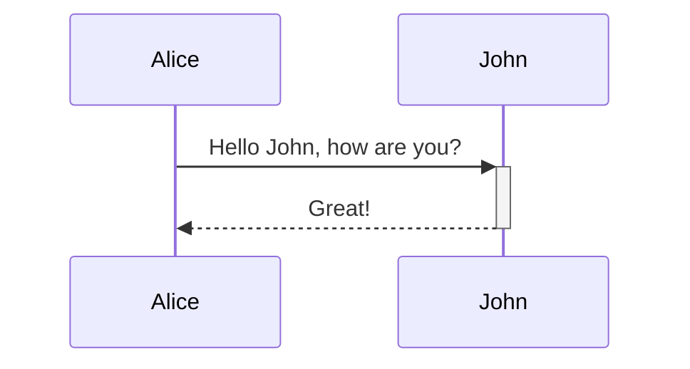

## Notes
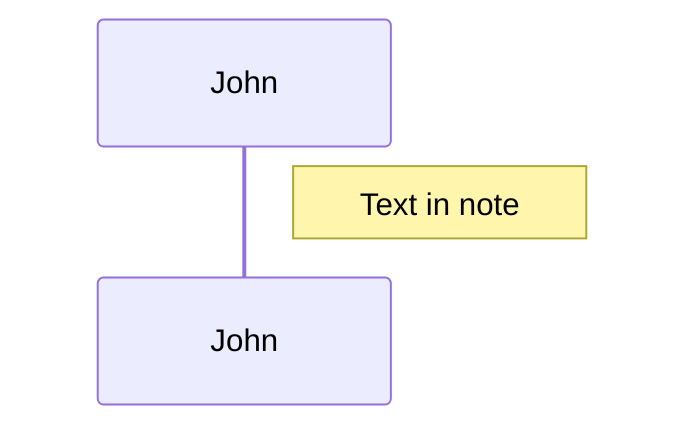

## Line breaks
Line break can be added to Note and Message:
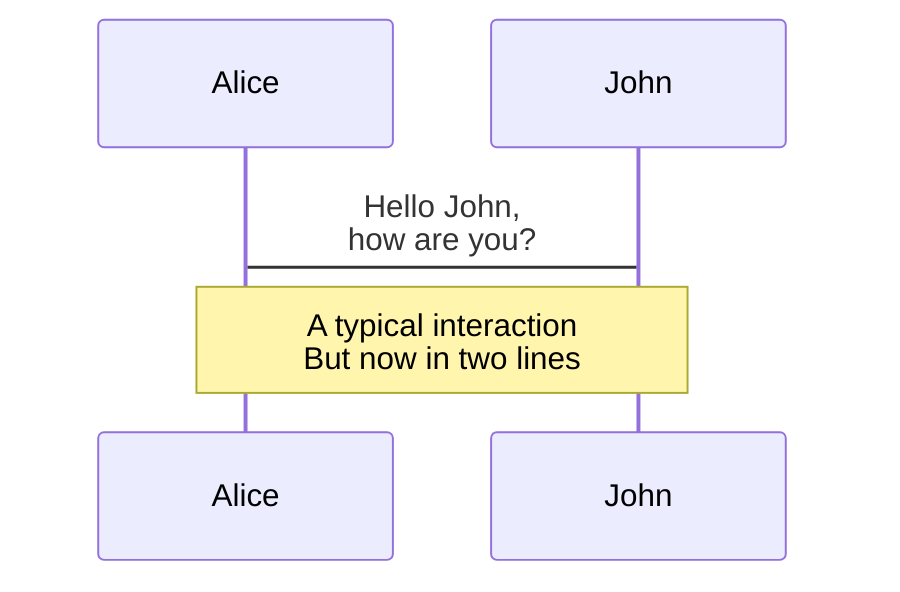

## Loops
```
loop Loop text
... statements ...
end
```

## Alt
```
alt Describing text
... statements ...
else
... statements ...
end
```

## Parallel
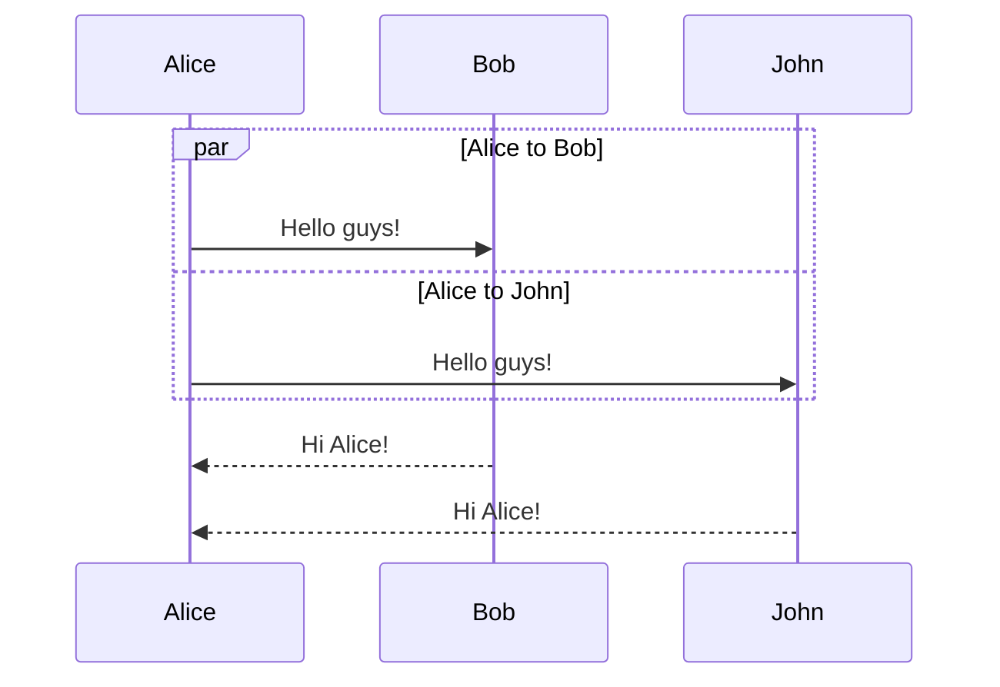

## Critical Region
It is possible to show actions that must happen automatically with conditional handling of circumstances.
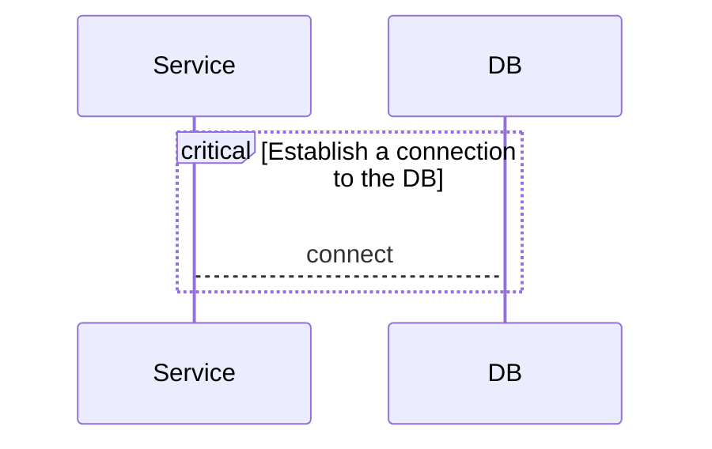

## Break
```
break [something happened]
... statements ...
end
```

## Background Highlighting
```
rect rgba(0, 0, 255, .1)
... content ...
end
```

## Comments
Comments can be entered within a sequence diagram, which will be ignored by the parser.
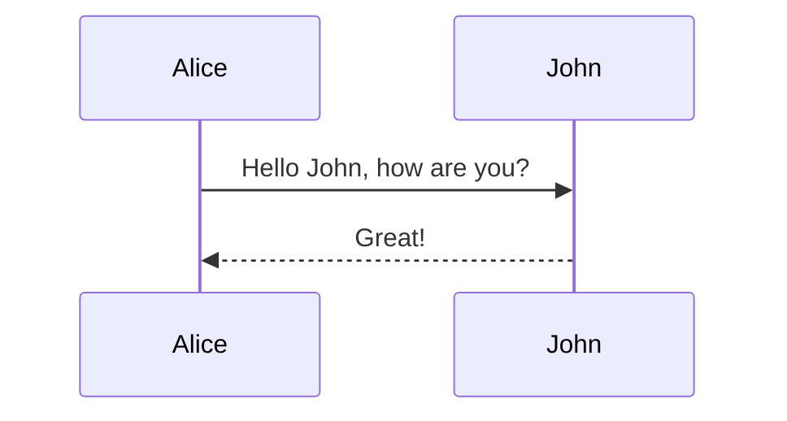

## Entity codes to escape characters
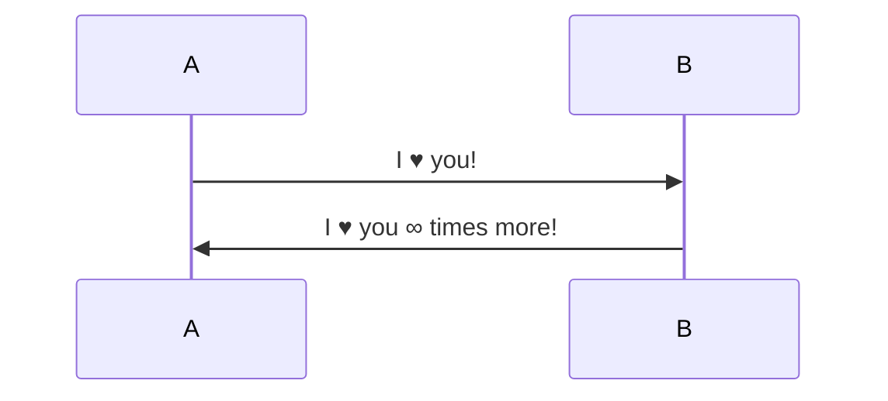
Because semicolons can be used instead of line breaks to define the markup, you need to use `#59;` to include a semicolon in message text.

### Start and Increment values (v11.15.0+)
```
autonumber <start> <increment>
```

## Actor Menus
```
link <actor>: <link-label> @ <link-url>
```
#### Advanced Menu Syntax
```
links <actor>: <json-formatted link-name link-url pairs>
```

### Possible configuration parameters:
| Parameter | Description | Default value |
|---|---|---|
| mirrorActors | Turns on/off the rendering of actors below the diagram as well as above it | false |
| noteAlign | Sets the text alignment for text in actor-attached notes | center |
