> Mermaid v12.1.0 · source: packages/mermaid/src/docs/syntax/zenuml.md · header: `zenuml` · since 10.0.0 · needs @mermaid-js/mermaid-zenuml

# ZenUML

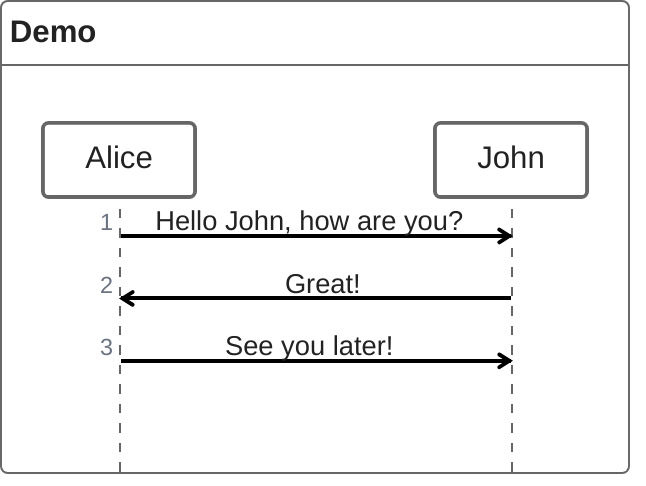

### Participants
The participants can be defined implicitly as in the first example on this page. The participants or actors are rendered in order of appearance in the diagram source text.
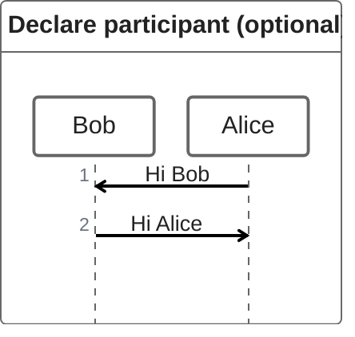

### Annotators
If you specifically want to use symbols instead of just rectangles with text you can do so by using the annotator syntax to declare participants as per below.
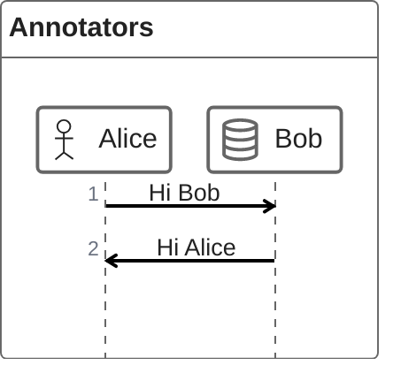

### Aliases
The participants can have a convenient identifier and a descriptive label.
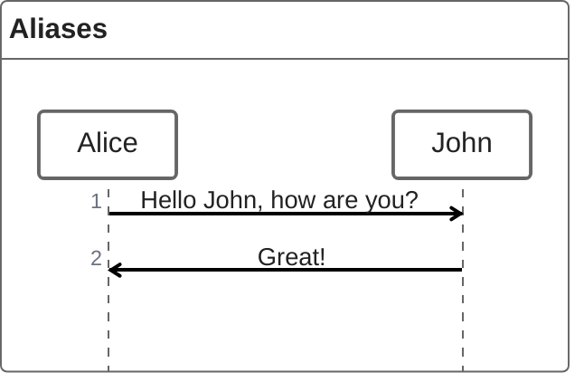

## Messages
Messages can be one of:

- Sync message
- Async message
- Creation message
- Reply message

### Sync message
You can think of a sync (blocking) method in a programming language.
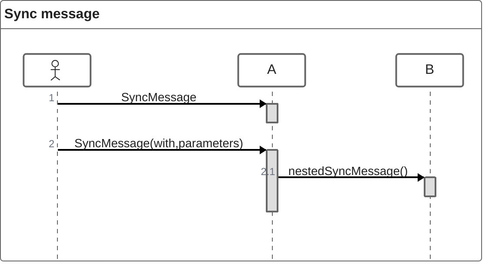

### Async message
You can think of an async (non-blocking) method in a programming language. Fire an event and forget about it.
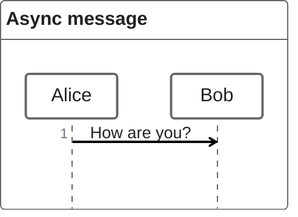

### Creation message
We use `new` keyword to create an object.
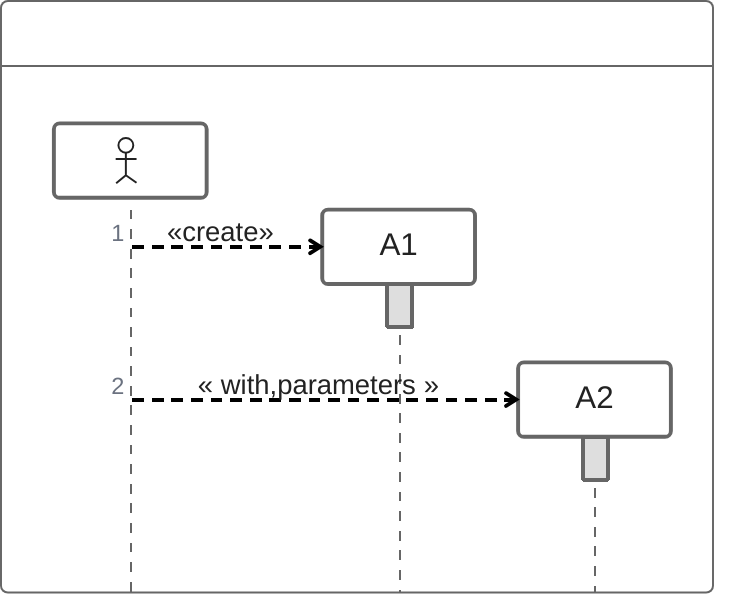

### Reply message
There are three ways to express a reply message:
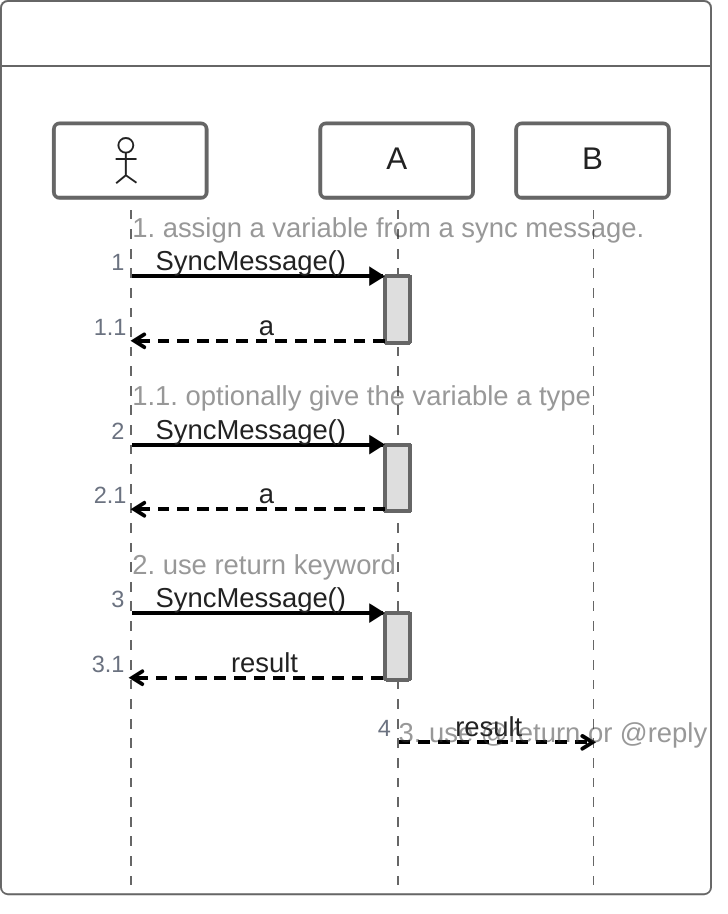
The third way `@return` is rarely used, but it is useful when you want to return to one level up.
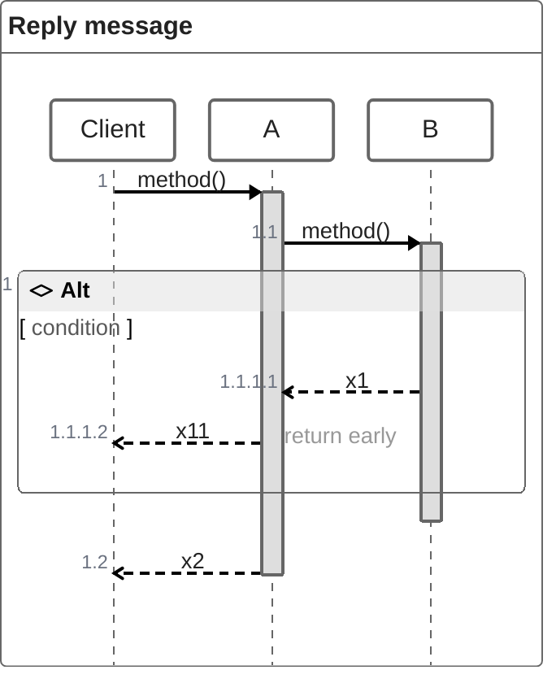

## Nesting
Sync messages and Creation messages are naturally nestable with `{}`.
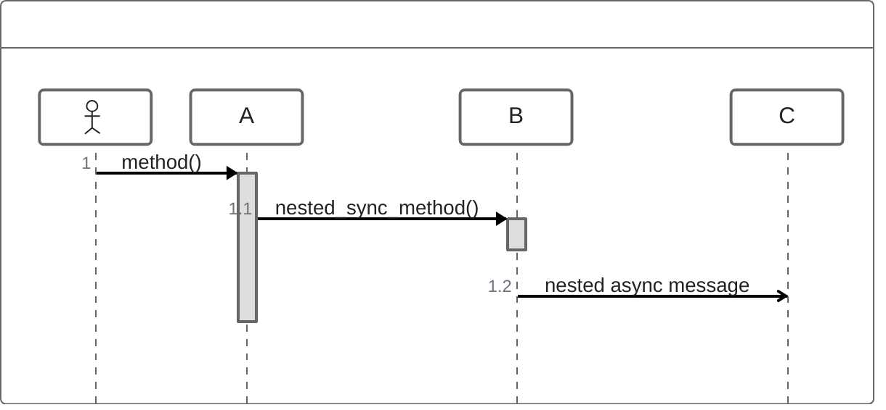

## Comments
It is possible to add comments to a sequence diagram with `// comment` syntax. Comments will be rendered above the messages or fragments. Comments on other places are ignored. Markdown is supported.

See the example below:
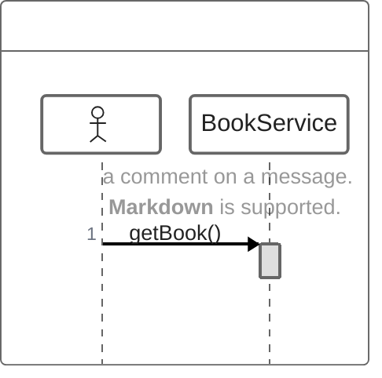

## Loops
It is possible to express loops in a ZenUML diagram. This is done by any of the following notations:

- while
- for
- forEach, foreach
- loop

See the example below:
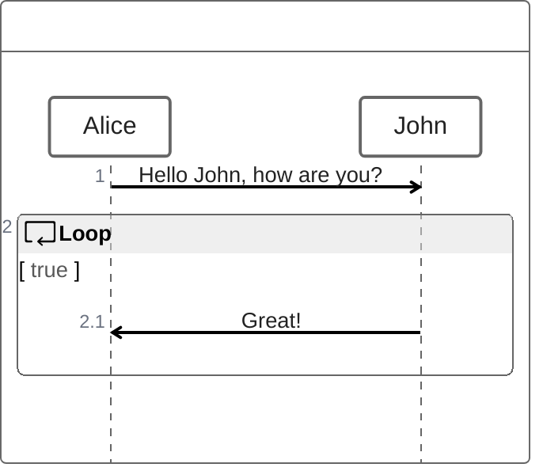

## Alt
It is possible to express alternative paths in a sequence diagram. This is done by the notation

See the example below:
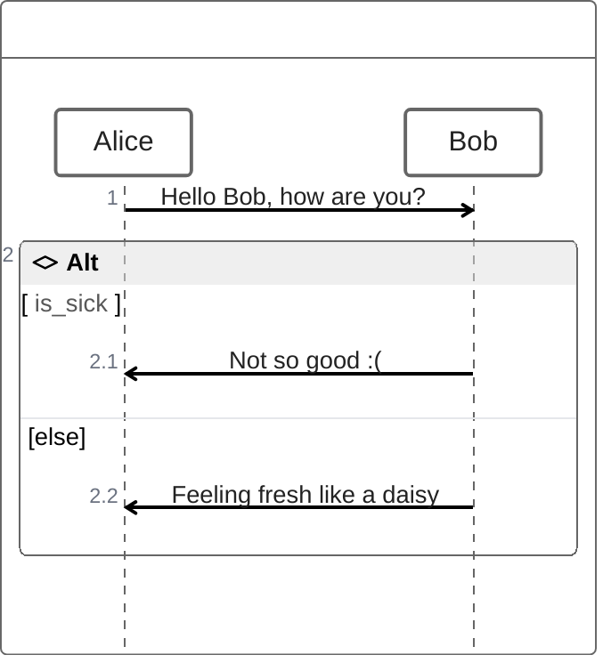

## Opt
It is possible to render an `opt` fragment. This is done by the notation

See the example below:
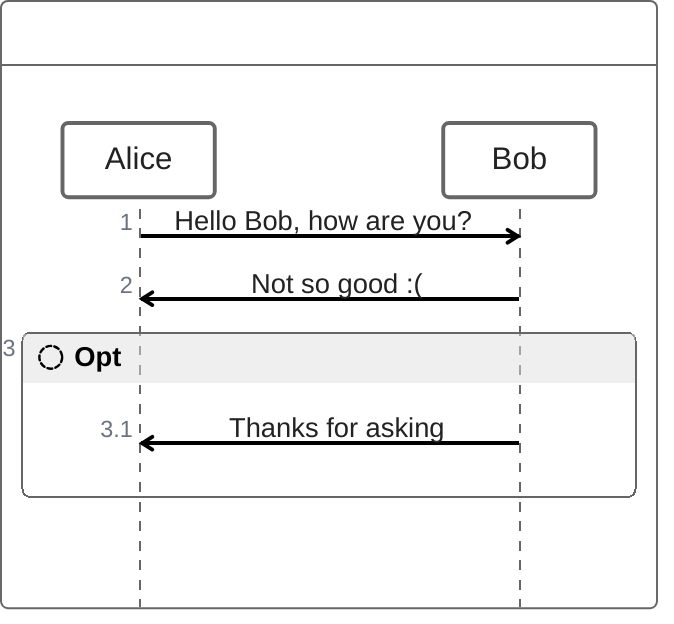

## Parallel
It is possible to show actions that are happening in parallel.

This is done by the notation

See the example below:
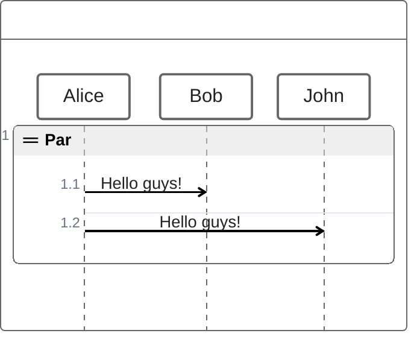

## Try/Catch/Finally (Break)
It is possible to indicate a stop of the sequence within the flow (usually used to model exceptions).

This is done by the notation
```
try {
  ...statements...
} catch {
  ...statements...
} finally {
  ...statements...
}
```
See the example below:
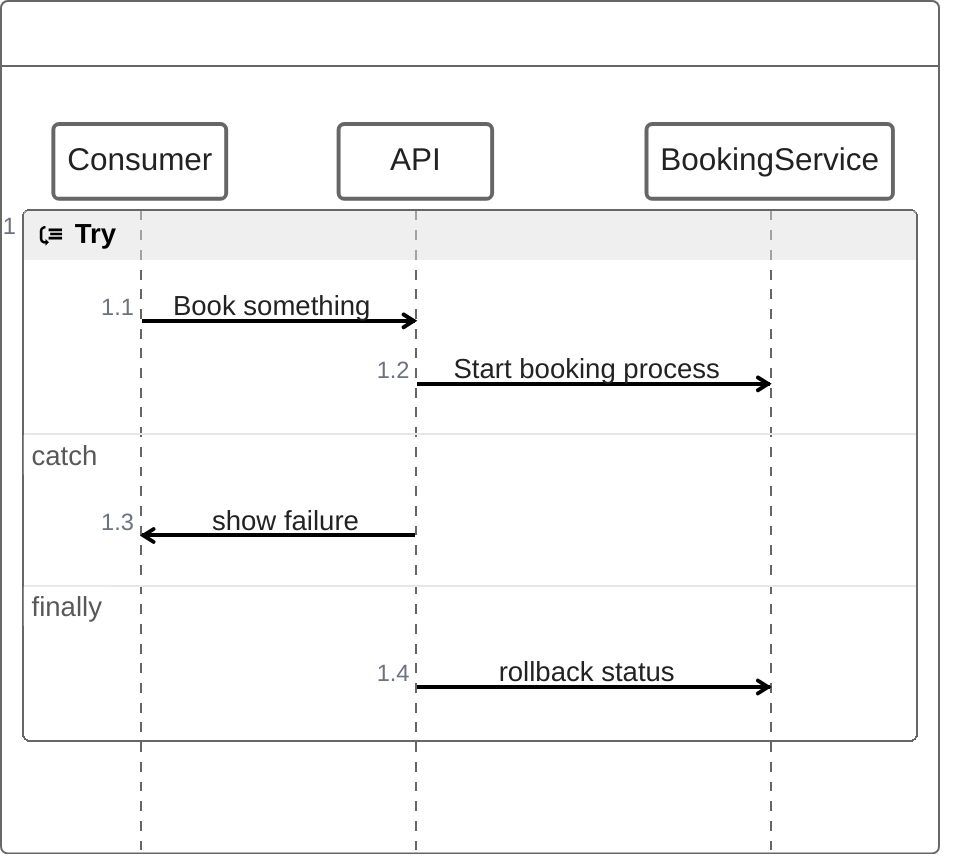

## Integrating with your library/website.
Zenuml uses the experimental lazy loading & async rendering features which could change in the future.
