# Every diagram type

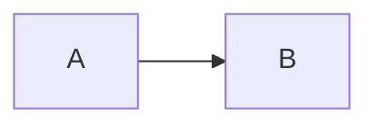

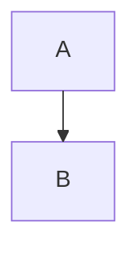

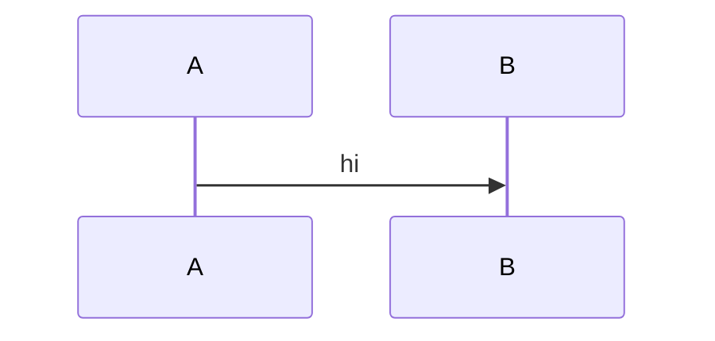

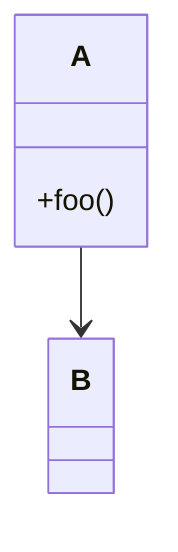


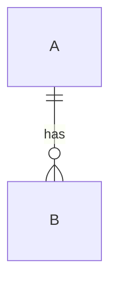

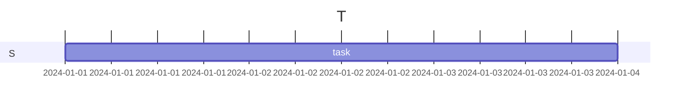

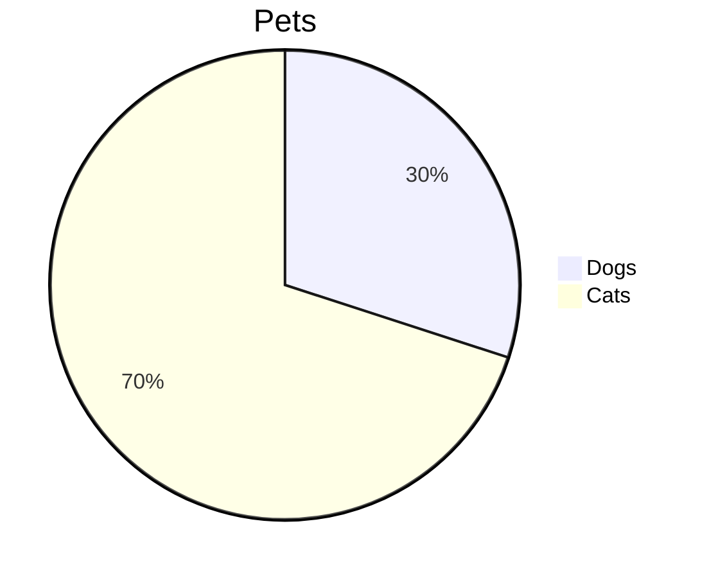

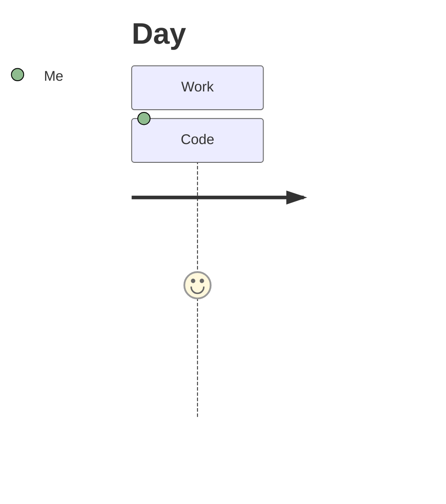

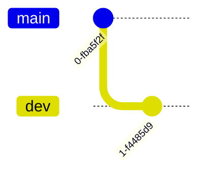

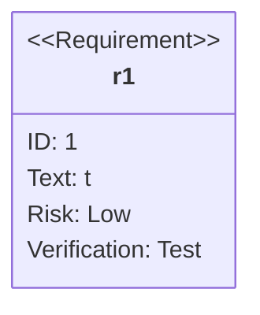

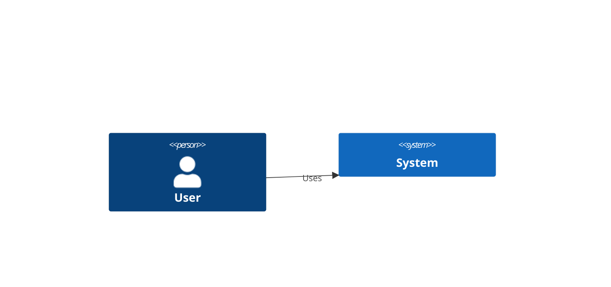

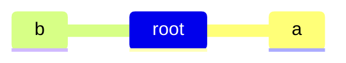

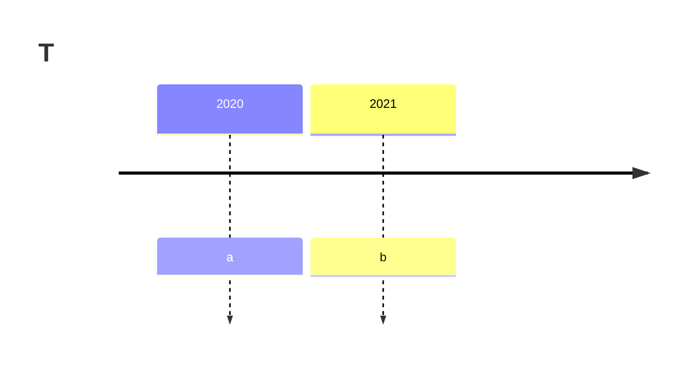

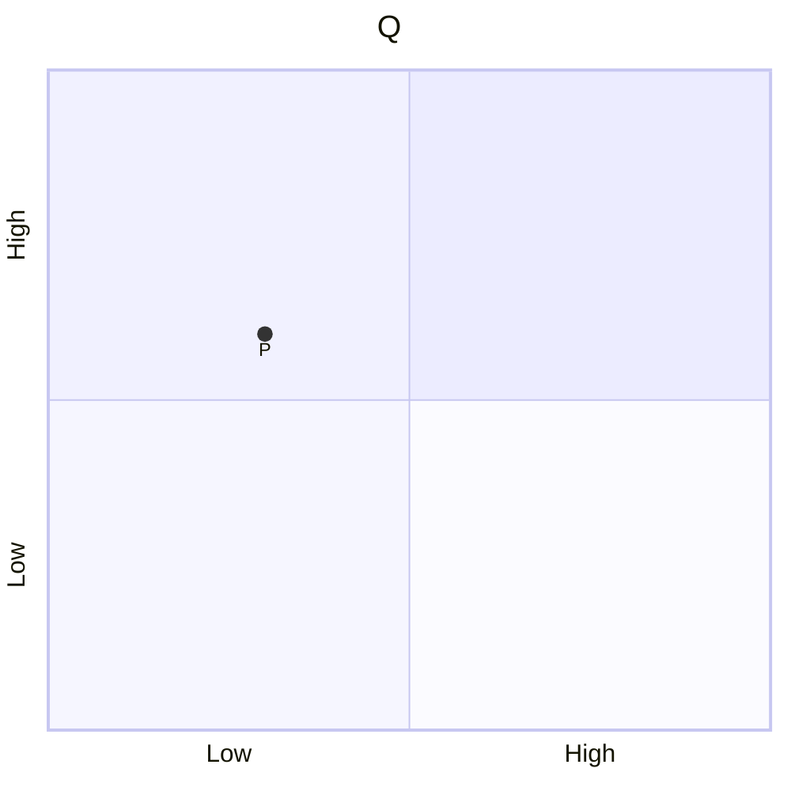

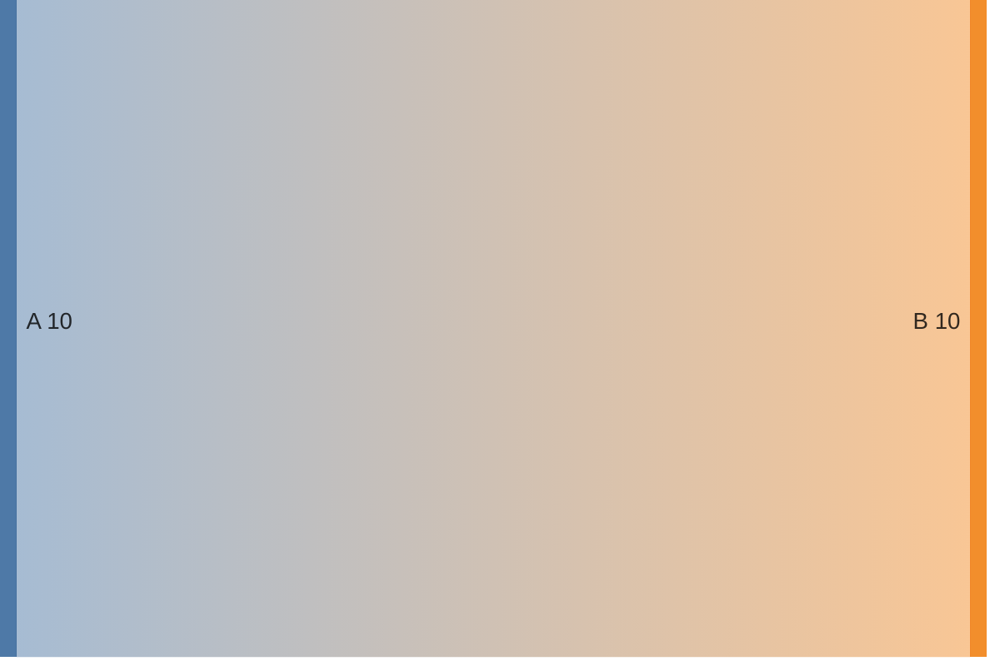

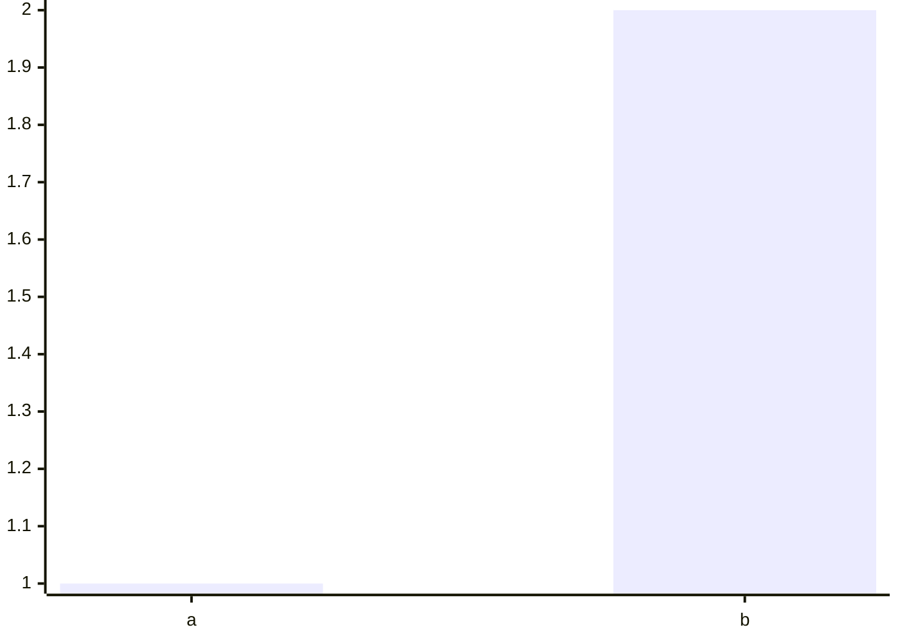

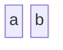

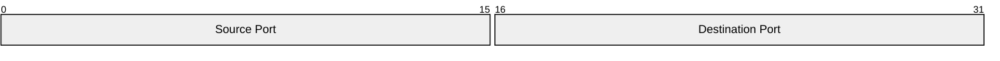


```mermaid
kanban
  todo[Todo]
    t1[Task]
```

```mermaid
radar-beta
  axis a, b, c
  curve x{1, 2, 3}
```

```mermaid
treemap-beta
  "Root"
    "Leaf": 10
```

```mermaid
venn-beta
  set A
  set B
```

```mermaid
ishikawa-beta
  Problem
    Cause
```

```mermaid
info
```

